# 🦀 CrabMusic

CrabMusic turns audio, videos, old TV, and 3D scenes into terminal art.
(The image channel currently shows a procedural placeholder; loading local
images is temporarily disabled in the app.)

Every visualizer starts from the same command. Pass a WAV file when you do not
have a live microphone:

```bash
cargo run -- --list-visualizers
cargo run -- --visualizer spectrum --input examples/tones/demo.wav
```

`examples/tones/demo.wav` is a synthetic bass/mid/treble tone, so the
visualizers run with no audio hardware. Omit `--input` to use the microphone
instead. Names, file input, and the capture command are documented below.

## ✨ Current Capabilities

- 🎞️ Play local videos or YouTube in terminal art
- 📼 Press `U` to jump through random Internet Archive channels and let the next show roll automatically
- 🎵 Visualize your mic or your system audio
- 🔊 Hear the audio while you watch
- 🧊 Load `.obj` files and spin, zoom, and inspect them
- 🌌 Fly through Primitives, Grid Tunnel, Gravity Well, and Starfield and steer them live


## 🎨 Gallery

### Braille Art Output

<p align="center">
  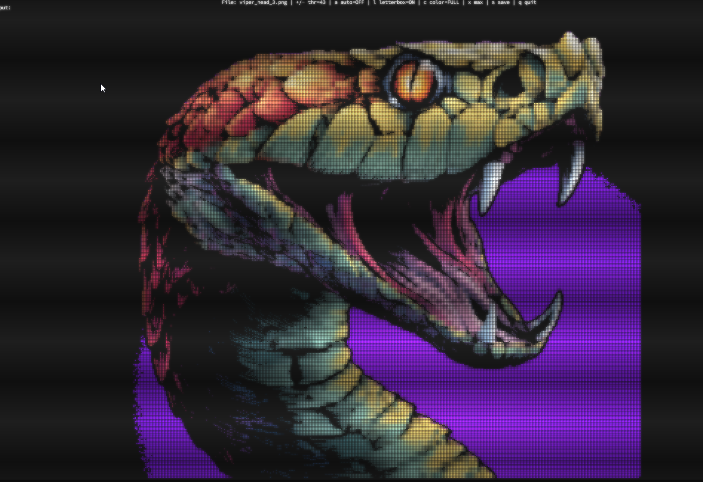
  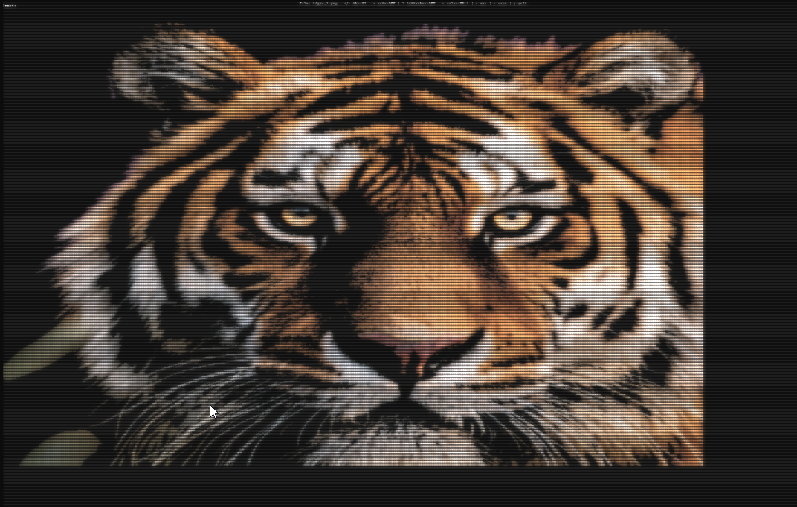
</p>

<p align="center">
  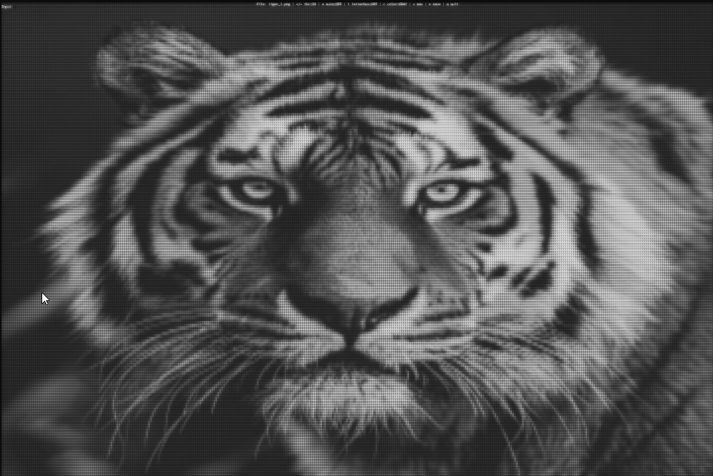
  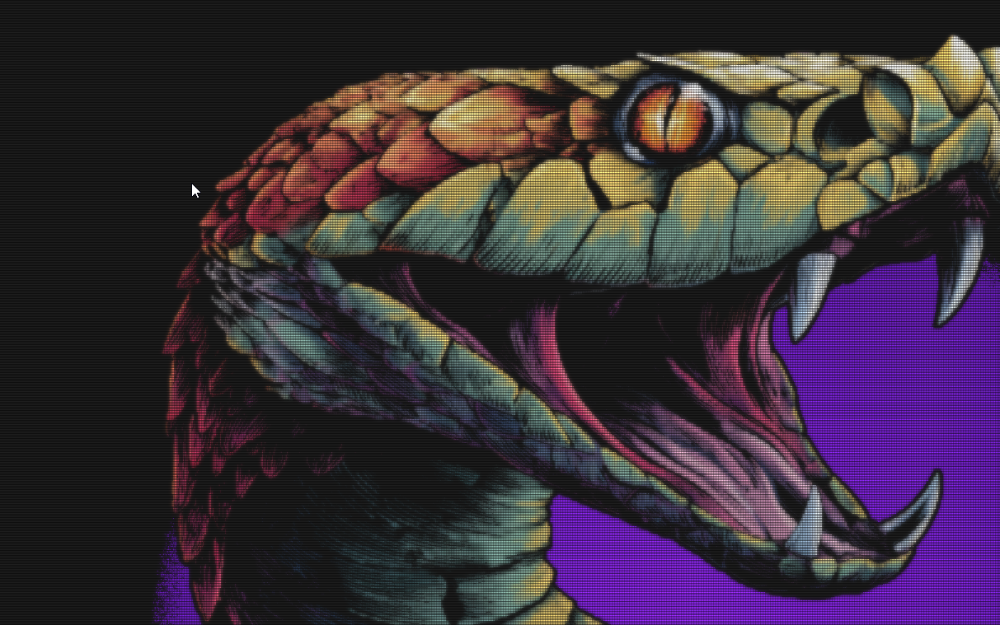
</p>

### Different Rendering Modes

<p align="center">
  
  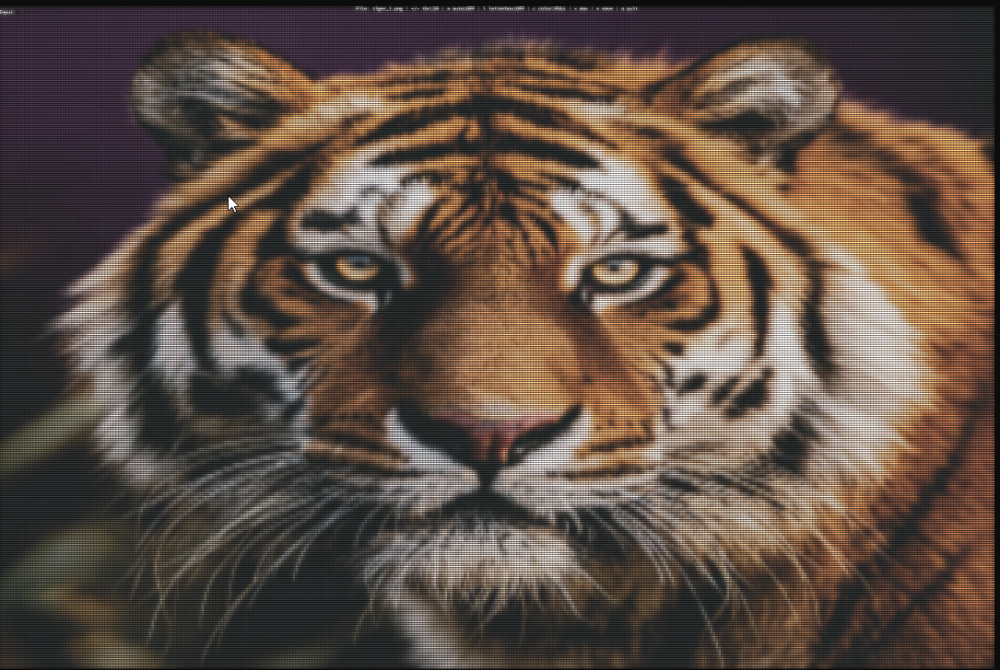
  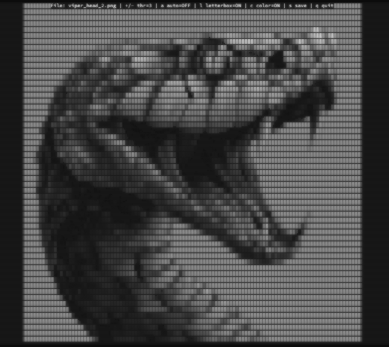
</p>

### Audio Visualization & Effects

<p align="center">
  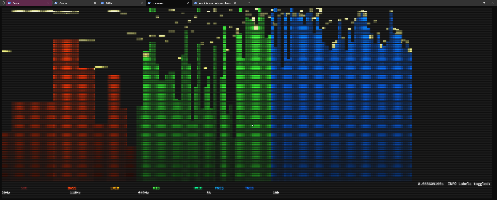
  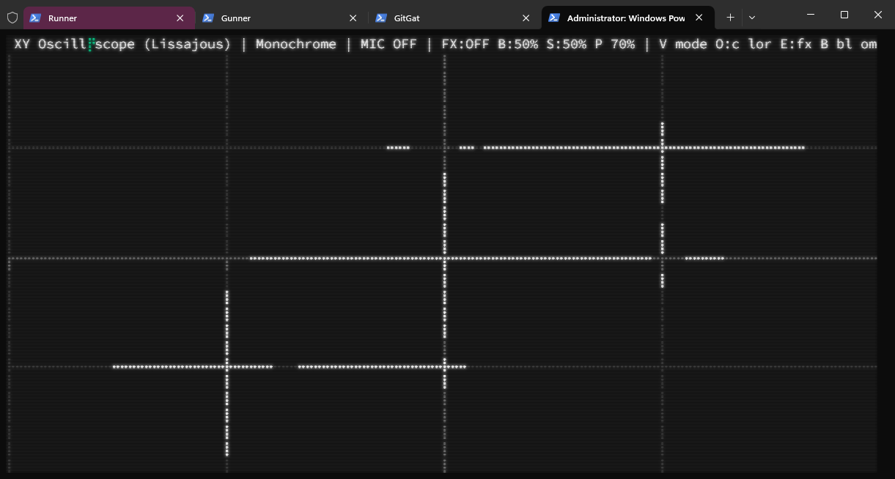
</p>

<p align="center">
  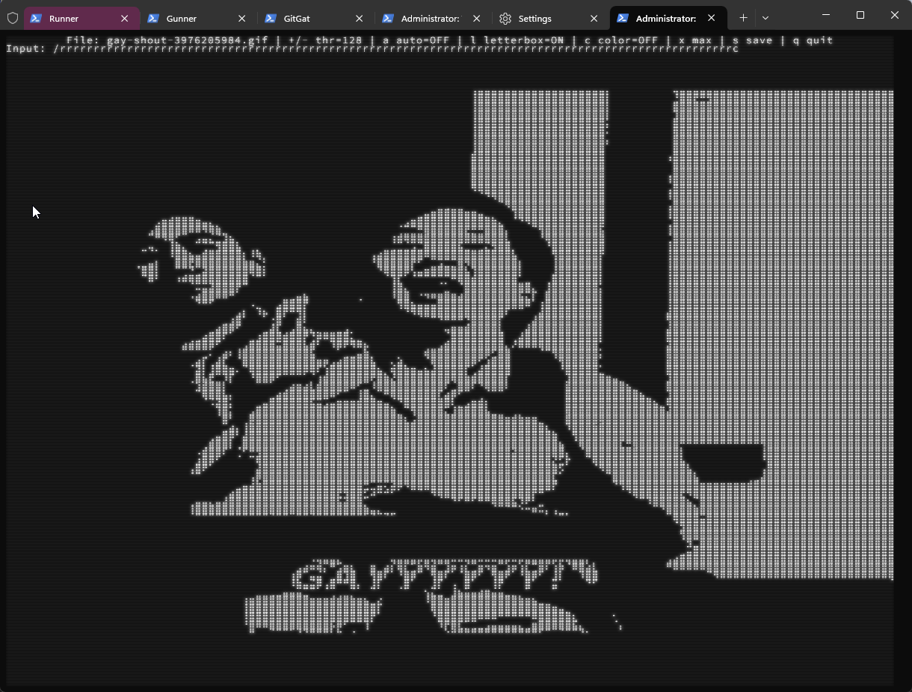
  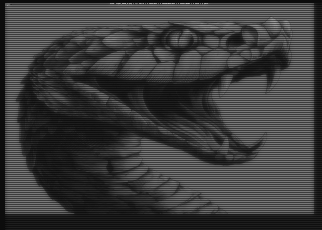
</p>


### 3D OBJ Viewer (Wireframe & Solid)

<p align="center">
  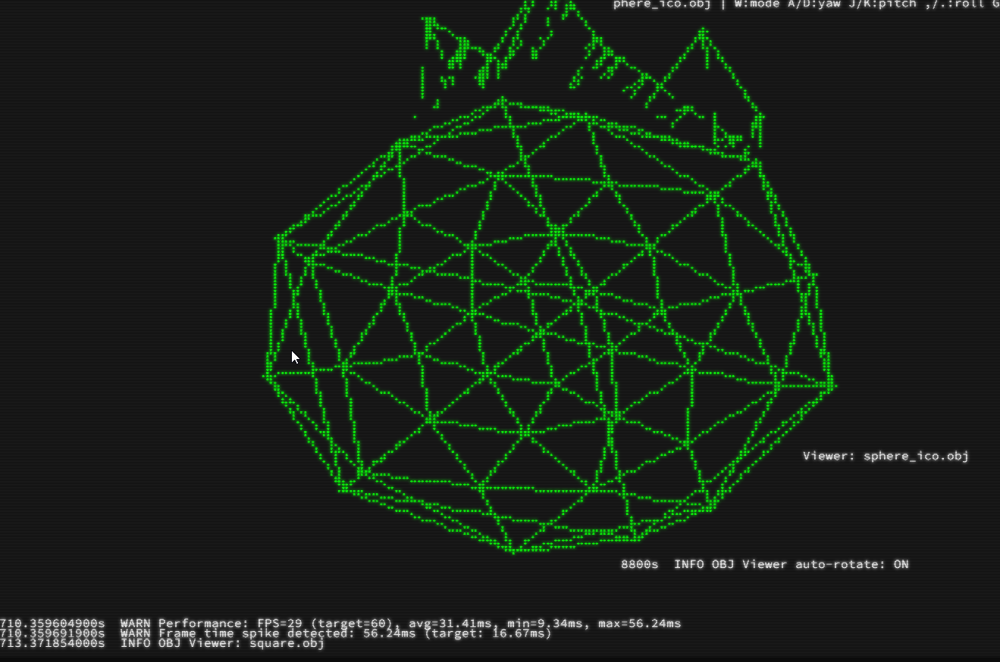
  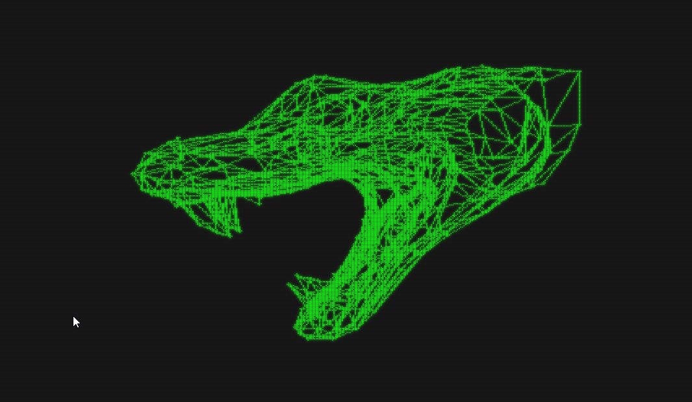
  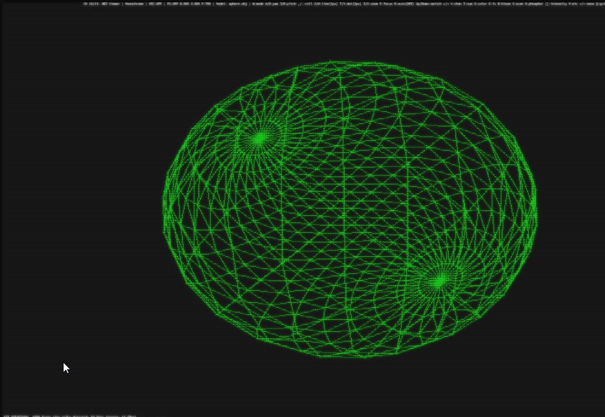
</p>

## 🚀 Quick Start

### Installation

```bash
# Clone the repository
git clone https://github.com/newjordan/crabmusic.git
cd crabmusic

# Build the project
cargo build --release

# Run with default settings (microphone input)
cargo run --release
```

### Quick Start: Images

The Image channel (`v` to cycle channels) currently renders a procedural
placeholder pattern. Loading images from the command line or by pasting a
path is temporarily disabled in the app, so there is no flag for it right
now.

### Quick Start: Audio

One entry point runs any visualizer. `--input` plays a WAV file in a loop, so
nothing needs to be recording:

```bash
# Every visualizer name
cargo run -- --list-visualizers

# Spectrum, oscilloscope, starfield, ... from a file
cargo run -- --visualizer spectrum --input examples/tones/demo.wav
cargo run -- --visualizer oscilloscope --input examples/tones/demo.wav
cargo run -- --visualizer starfield --input path/to/song.wav

# Live microphone instead of a file
cargo run --release -- --list-devices
cargo run --release -- --device "Microphone" --visualizer spectrum
```

WAV input accepts PCM (8, 16, 24, or 32-bit) and 32-bit float, mono or stereo.
Regenerate the bundled tone with:

```bash
cargo run -- --write-tone examples/tones/demo.wav
```

Windows system audio (WASAPI loopback) is enabled through the config file
instead of a flag: set `audio.use_loopback: true` in your `config.yaml`.
On other platforms loopback capture is not supported. `--input` does not use
loopback or the microphone.

### Quick Start: Video

```bash
# Play a local video file as Braille
cargo run --release -- --video "media/clip.mp4"

# Or play a YouTube URL/channel/playlist via yt-dlp resolution
cargo run --release -- --video "https://www.youtube.com/watch?v=dQw4w9WgXcQ"
```

Notes:
- Local file playback still works as before.
- YouTube watch/short/channel/playlist URLs are resolved through `yt-dlp` into a direct stream URL before FFmpeg playback.
- For channel/playlist URLs, CrabMusic samples a random video from the first slice of results.

### Quick Start: 3D OBJ Viewer

- Put your `.obj` files in the `models/` folder (we ignore `.mtl`).
- Run the app (`cargo run`) and switch to the “OBJ Viewer” channel (use ←/→ to change channels; the status bar lists keys).
- Use Up/Down to switch between OBJ files.

Controls (OBJ Viewer):
- W: toggle Wireframe/Solid
- A/D: yaw left/right
- J/K: pitch down/up
- ,/.: roll CCW/CW
- Z/X: zoom in/out
- F: focus (fit to view)
- G/H: line thickness (wireframe)
- T/Y: vertex dot size (wireframe)
- R: auto‑rotate ON/OFF

Notes:
- Wireframe rendering shows real mesh edges and vertices with hidden‑line removal (depth‑tested) so back/occluded edges don’t clutter.
- Solid mode uses simple diffuse lighting; if normals are missing in the OBJ, we fall back to flat shading safely.
- OBJ loader supports 1‑based and negative indices and triangulates n‑gons by fan. Texture/MTL are ignored for now.

### Quick Start: Retro 3D Channels

- Switch to `Primitives`, `Grid Tunnel`, `Gravity Well`, or `Starfield` with `←/→`.
- Each mode stays beat-reactive, but now you can steer/tune it live too.

Controls:
- `Primitives`: `A/D` yaw, `J/K` pitch, `,/.` roll, `Z/X` zoom, `R` auto-rotate
- `Grid Tunnel`: `A/D` twist, `J/K` speed, `,/.` glow, `Z/X` zoom, `R` auto-roll
- `Gravity Well`: audio-reactive dual-view channel with a warped top grid plus a falling-depth side view
- `Starfield`: `A/D` twist, `J/K` speed, `,/.` trail gain, `Z/X` FOV, `R` auto-twist


### More

```bash
# List audio devices
cargo run --release -- --list-devices

# Show all options
cargo run --release -- --help
```

## Visualizer captures

These frames were rendered headlessly from `examples/tones/demo.wav`, a synthetic tone with an 82 Hz bass, 440 Hz and 659 Hz mids, and a 3520 Hz treble partial. Regenerate them with:

```bash
cargo run -- --input examples/tones/demo.wav --capture-dir docs/captures
```

Add `--visualizer <name>` to capture one mode. Ray-traced modes (`raycaster3d`, `obj-viewer`, `primitives`) keep the same renderers and are captured after a few frames.

### Sine Wave

```text
        ⡜⠉⠉⠉⠉⠉⠉⠉⠉⠉⠉⠉⠹⡀                 ⢸⠉⠉⠉⠉⠉⠉⠉⠉⠉⠉⠉⠉⡆           
        ⡇            ⡇                 ⡇            ⢇           
       ⢰⠁            ⢇                 ⡇            ⢸           
       ⢸             ⢸                ⢰⠁            ⢸           
       ⡸             ⢸                ⢸             ⠈⡆          
       ⡇             ⠈⡆               ⢸              ⡇          
       ⡇              ⡇               ⡇              ⢇          
      ⢠⠃              ⡇               ⡇              ⢸          
      ⢸               ⢸              ⢀⠇              ⢸          
      ⢸               ⢸              ⢸               ⠘⡄         
      ⡎               ⠘⡄             ⢸                ⡇         
      ⡇                ⡇             ⡎                ⡇         
     ⢀⠇                ⡇             ⡇                ⢸         
     ⢸                 ⢱            ⢀⠇                ⢸         
     ⢸                 ⢸            ⢸                 ⠸⡀        
⣀⣀⣀⣀⣀⡇                 ⠈⣆⣀⣀⣀⣀⣀⣀⣀⣀⣀⣀⣀⡜                  ⣇⣀⣀⣀⣀⣀⣀⣀⣀
```

### Spectrum

```text
       ⣿⣿⣿⣿⣿⣿⣿⣿           ⢸   ⡆                                 
       ⣿⣿⣿⣿⣿⣿⣿⣿           ⢸   ⡇                                 
       ⣿⣿⣿⣿⣿⣿⣿⣿           ⢸   ⡇                                 
       ⣿⣿⣿⣿⣿⣿⣿⣿           ⢸   ⡇                                 
       ⣿⣿⣿⣿⣿⣿⣿⣿           ⢸   ⡇                                 
       ⣿⣿⣿⣿⣿⣿⣿⣿           ⢸   ⡇                                 
       ⣿⣿⣿⣿⣿⣿⣿⣿           ⣿   ⡇                                 
       ⣿⣿⣿⣿⣿⣿⣿⣿           ⣿⡄  ⣷             ⢠                   
       ⣿⣿⣿⣿⣿⣿⣿⣿           ⣿⡇  ⣿             ⢸                   
 ⣿⣿⣿⣿⣿⣿⣿⣿⣿⣿⣿⣿⣿⣿           ⣿⡇ ⢸⣿             ⢸                   
⣶⣿⣿⣿⣿⣿⣿⣿⣿⣿⣿⣿⣿⣿⣿⣿⣷⣦⣤⣤⣤⣤⣴⣦⣤⣾⣿⣷⣦⣾⣿⣦⣤⣤⣤⣤⣤⣤⣤⣤⣤⣤⣤⣤⣼⣤⣤⣤⣤⣤⣤⣤⣤⣤⣤⣤⣤⣤⣤⣤    
⣿⣿⣿⣿⣿⣿⣿⣿⣿⣿⣿⣿⣿⣿⣿⣿⣿⣿⣿⣿⣿⣿⣿⣿⣿⣿⣿⣿⣿⣿⣿⣿⣿⣿⣿⣿⣿⣿⣿⣿⣿⣿⣿⣿⣿⣿⣿⣿⣿⣿⣿⣿⣿⣿⣿⣿⣿⣿⣿⣿    
⣿⣿⣿⣿⣿⣿⣿⣿⣿⣿⣿⣿⣿⣿⣿⣿⣿⣿⣿⣿⣿⣿⣿⣿⣿⣿⣿⣿⣿⣿⣿⣿⣿⣿⣿⣿⣿⣿⣿⣿⣿⣿⣿⣿⣿⣿⣿⣿⣿⣿⣿⣿⣿⣿⣿⣿⣿⣿⣿⣿    
                                                                
                                                                
                                                                
```

### Oscilloscope

```text
                 ⡆ ⢸⡇              ⢀⡇ ⢠           ⢠⡇  ⢸         
⢸⡇              ⢠⢣ ⢸⡇           ⢸  ⢸⢱ ⣾           ⢸⢸  ⡜⡄        
⢸⢣  ⣴           ⢸⢸ ⡎⢣           ⣿  ⡜⢸ ⣿         ⢰ ⢸⢸  ⡇⡇        
⡸⢸  ⡿⡀          ⢸⢸ ⡇⢸           ⡇⡇⢰⠇⢸ ⡟⡄        ⢸⡆⢸⠈⣶⡀⡇⡇        
⡇⢞⢇⢸⢞⡇          ⡸⠈⡆⡇⢸  ⢰        ⡇⡇⡎⡵⢸ ⡇⡇        ⡜⡇⢸⣫⡇⣷⠁⡇       ⢰
⡇⣫⠸⡸⣫⡇ ⡄        ⡇⣞⡇⡇⢸  ⣾        ⡇⡇⡇⣞⢸⢠⠃⡇        ⡇⡇⡜⣵⣫⢸⣵⡇       ⢸
⠇⣿⣿⠃⣿⡇ ⣷     ⣼  ⡇⣿⣿⣿⠘⣄⡀⣿     ⢠ ⢸⣿⢸⠁⣿⣿⣿⣿⡇        ⡇⡇⡇⣿⣿⣿⣿⢱ ⣾     ⢸
⣿⣿⣿⣿⣿⢣⢠⢻   ⡄ ⡟⡄⢀⠇⣿⠸⣿⣿⡟⢧⠋⡆    ⢸⡀⢸⣿⠘⣿⣿⣿⣿⣿⡇  ⡆    ⢀⠇⢱⡇⣿⣿⣿⣿⢸ ⣿     ⡎
·⠉⠉⠉⠉⢸⢸⢸⣿⣿·⡇⣿⡇⠷⠻⠉⠉⠉⠉·⠁⠸⠉⡇⢰⡇⣿⣿⡇·⢸⠉⠉⠉⠉⠉⣿⠉⢸·⢀⡇⣿⣿⡆⣿⢸⠉⢸·⠉⠉⠉⠉⢸⢸⠈⡆⣿·⣿⣿⡇
     ⢸⢸⠘⡄⣿⢸⡇⣿⡇          ⡇⢸⡇⣿⣿⡇⡇⢸     ⡟ ⠸⡄⢸⢸⣿⢸⡇⣿⡜ ⢸⡇    ⢸⢸ ⡇⣿⣿⡆⣿⡇
     ⢸⡸ ⡇⣻⢸⢱⢰⠁          ⡇⢸⢣⣻⢟⡇⢣⡸        ⢇⢸⢸⢟⢸⢸⢟⡇ ⠸⠁    ⢸⢸ ⡇⡿⢀⢷⡿⡇
      ⡇ ⡇⡵⡸⢸⢸           ⡇⢸⢸⡵⢀⠇⢸⡇        ⢸⡜⢸⣫⢸⢸⢠⠃       ⠈⡎ ⡇⢞⢸⢸⢞⡇
      ⠁ ⡇⣄⡇⢸⢸           ⡇⡇⢸⢞⢸ ⠸⡇        ⠘⡇⢸⡵⡎⢸⢸         ⠇ ⢇⣫⢸⢸⣫⡇
        ⢱⠉⠇⢸⢸           ⢸⡇⠘⣤⢸            ⠁⠈⡆⡇⠈⡾           ⢸⢀⠇⠘⣼ 
        ⠈  ⠈⡾           ⢸⡇ ⠉⠎              ⡇⡇ ⠇           ⢸⡸  ⣿ 
            ⡇           ⢸⠃                 ⣷⠁             ⠘⡇  ⣿ 
```

### XY Oscilloscope

```text
⠀⠀⠀⠀⠀⠀⠀⠀⠀⠀⠀⠀⠀⠀⠀⠀⠀⠀⠀⠀⠀⠀⠀⠀⠀⠀⠀⠀⠀⠀⠀⠀⠀⠀⠀⠀⠀⠀⠀⠀⠀⠀⠀⠀⠀⠀⠀⠀⠀⠀⠀⠀⠀⠀⠀⠀⠀⠀⠀⠀⢀⡀⠀⠀
⠀⠀⠀⠀⠀⠀⠀⠀⠀⠀⠀⠀⠀⠀⠀⠀⠀⠀⠀⠀⠀⠀⠀⠀⠀⠀⠀⠀⠀⠀⠀⠀⠀⠀⠀⠀⠀⠀⠀⠀⠀⠀⠀⠀⠀⠀⠀⠀⠀⠀⠀⠀⠀⠀⠀⠀⣀⣤⡴⠞⠋⠀⠀⠀
⠀⠀⠀⠀⠀⠀⠀⠀⠀⠀⠀⠀⠀⠀⠀⠀⠀⠀⠀⠀⠀⠀⠀⠀⠀⠀⠀⠀⠀⠀⠀⠀⠀⠀⠀⠀⠀⠀⠀⠀⠀⠀⠀⠀⠀⠀⠀⠀⠀⠀⠀⠀⣀⣤⡶⠟⠋⠁⠀⠀⠀⠀⠀⠀
⠀⠀⠀⠀⠀⠀⠀⠀⠀⠀⠀⠀⠀⠀⠀⠀⠀⠀⠀⠀⠀⠀⠀⠀⠀⠀⠀⠀⠀⠀⠀⠀⠀⠀⠀⠀⠀⠀⠀⠀⠀⠀⠀⠀⠀⠀⠀⠀⣀⣤⡶⠟⠋⠁⠀⠀⠀⠀⠀⠀⠀⠀⠀⠀
⠀⠀⠀⠀⠀⠀⠀⠀⠀⠀⠀⠀⠀⠀⠀⠀⠀⠀⠀⠀⠀⠀⠀⠀⠀⠀⠀⠀⠀⠀⠀⠀⠀⠀⠀⠀⠀⠀⠀⠀⠀⠀⠀⠀⣀⣤⡶⠟⠋⠁⠀⠀⠀⠀⠀⠀⠀⠀⠀⠀⠀⠀⠀⠀
⠀⠀⠀⠀⠀⠀⠀⠀⠀⠀⠀⠀⠀⠀⠀⠀⠀⠀⠀⠀⠀⠀⠀⠀⠀⠀⠀⠀⠀⠀⠀⠀⠀⠀⠀⠀⠀⠀⠀⠀⣀⣤⡶⠟⠋⠁⠀⠀⠀⠀⠀⠀⠀⠀⠀⠀⠀⠀⠀⠀⠀⠀⠀⠀
⠀⠀⠀⠀⠀⠀⠀⠀⠀⠀⠀⠀⠀⠀⠀⠀⠀⠀⠀⠀⠀⠀⠀⠀⠀⠀⠀⠀⠀⠀⠀⠀⠀⠀⠀⠀⢀⣠⡴⠞⠋⠁⠀⠀⠀⠀⠀⠀⠀⠀⠀⠀⠀⠀⠀⠀⠀⠀⠀⠀⠀⠀⠀⠀
⠀⠀⠀⠀⠀⠀⠀⠀⠀⠀⠀⠀⠀⠀⠀⠀⠀⠀⠀⠀⠀⠀⠀⠀⠀⠀⠀⠀⠀⠀⠀⠀⣀⣤⠶⠚⠉⠁⠀⠀⠀⠀⠀⠀⠀⠀⠀⠀⠀⠀⠀⠀⠀⠀⠀⠀⠀⠀⠀⠀⠀⠀⠀⠀
⠀⠀⠀⠀⠀⠀⠀⠀⠀⠀⠀⠀⠀⠀⠀⠀⠀⠀⠀⠀⠀⠀⠀⠀⠀⠀⠀⠀⣀⣤⡶⠟⠉⠀⠀⠀⠀⠀⠀⠀⠀⠀⠀⠀⠀⠀⠀⠀⠀⠀⠀⠀⠀⠀⠀⠀⠀⠀⠀⠀⠀⠀⠀⠀
⠀⠀⠀⠀⠀⠀⠀⠀⠀⠀⠀⠀⠀⠀⠀⠀⠀⠀⠀⠀⠀⠀⠀⠀⣀⣤⡶⠟⠉⠀⠀⠀⠀⠀⠀⠀⠀⠀⠀⠀⠀⠀⠀⠀⠀⠀⠀⠀⠀⠀⠀⠀⠀⠀⠀⠀⠀⠀⠀⠀⠀⠀⠀⠀
⠀⠀⠀⠀⠀⠀⠀⠀⠀⠀⠀⠀⠀⠀⠀⠀⠀⠀⠀⠀⣀⣤⡶⠛⠉⠀⠀⠀⠀⠀⠀⠀⠀⠀⠀⠀⠀⠀⠀⠀⠀⠀⠀⠀⠀⠀⠀⠀⠀⠀⠀⠀⠀⠀⠀⠀⠀⠀⠀⠀⠀⠀⠀⠀
⠀⠀⠀⠀⠀⠀⠀⠀⠀⠀⠀⠀⠀⠀⠀⠀⣀⣤⡶⠟⠉⠁⠀⠀⠀⠀⠀⠀⠀⠀⠀⠀⠀⠀⠀⠀⠀⠀⠀⠀⠀⠀⠀⠀⠀⠀⠀⠀⠀⠀⠀⠀⠀⠀⠀⠀⠀⠀⠀⠀⠀⠀⠀⠀
⠀⠀⠀⠀⠀⠀⠀⠀⠀⠀⠀⠀⣀⣤⡶⠟⠋⠁⠀⠀⠀⠀⠀⠀⠀⠀⠀⠀⠀⠀⠀⠀⠀⠀⠀⠀⠀⠀⠀⠀⠀⠀⠀⠀⠀⠀⠀⠀⠀⠀⠀⠀⠀⠀⠀⠀⠀⠀⠀⠀⠀⠀⠀⠀
⠀⠀⠀⠀⠀⠀⠀⠀⣀⣤⠴⠟⠋⠁⠀⠀⠀⠀⠀⠀⠀⠀⠀⠀⠀⠀⠀⠀⠀⠀⠀⠀⠀⠀⠀⠀⠀⠀⠀⠀⠀⠀⠀⠀⠀⠀⠀⠀⠀⠀⠀⠀⠀⠀⠀⠀⠀⠀⠀⠀⠀⠀⠀⠀
⠀⠀⠀⠀⢀⣤⠶⠛⠉⠀⠀⠀⠀⠀⠀⠀⠀⠀⠀⠀⠀⠀⠀⠀⠀⠀⠀⠀⠀⠀⠀⠀⠀⠀⠀⠀⠀⠀⠀⠀⠀⠀⠀⠀⠀⠀⠀⠀⠀⠀⠀⠀⠀⠀⠀⠀⠀⠀⠀⠀⠀⠀⠀⠀
⠀⠀⠀⠚⠉⠀⠀⠀⠀⠀⠀⠀⠀⠀⠀⠀⠀⠀⠀⠀⠀⠀⠀⠀⠀⠀⠀⠀⠀⠀⠀⠀⠀⠀⠀⠀⠀⠀⠀⠀⠀⠀⠀⠀⠀⠀⠀⠀⠀⠀⠀⠀⠀⠀⠀⠀⠀⠀⠀⠀⠀⠀⠀⠀
```

### Raycaster 3D

```text
⠀⠀⠀⠀⠀⠀⠀⠀⠀⠀⠀⠀⠀⠀⠀⠀⠀⠀⠀⠀⠀⠀⠀⠀⠀⠀⠀⠀⠀⠀⠀⠀⠀⠀⠀⠀⠀⠀⠀⠀⠀⠀⠀⠀⠀⠀⠀⠀⠀⠀⠀⠀⠀⠀⠀⠀⠀⠀⠀⠀⠀⠀⠀⠀
⠀⠀⠀⠀⠀⠀⠀⠀⠀⠀⠀⠀⠀⠀⠀⠀⠀⠀⠀⠀⠀⠀⠀⠀⠀⠀⠀⠀⠀⠀⠀⠀⠀⠀⠀⠀⠀⠀⠀⠀⠀⠀⠀⠀⠀⠀⠀⠀⠀⠀⠀⠀⠀⠀⠀⠀⠀⠀⠀⠀⠀⠀⠀⠀
⠀⠀⠀⠀⠀⠀⠀⠀⠀⠀⠀⠀⠀⠀⠀⠀⠀⠀⠀⠀⠀⠀⠀⠀⠀⠀⠀⠀⠀⠀⠀⠀⠀⠀⠀⠀⠀⠀⠀⠀⠀⠀⠀⠀⠀⠀⠀⠀⠀⠀⠀⠀⠀⠀⠀⠀⠀⠀⠀⠀⠀⠀⠀⠀
⠀⠀⠀⠀⠀⠀⠀⠀⠀⠀⠀⠀⠀⠀⠀⠀⠀⠀⠀⠀⠀⠀⠀⠀⠀⠀⠀⠀⠀⠀⠀⠀⠀⠀⠀⠀⠀⠀⠀⠀⠀⠀⠀⠀⠀⠀⠀⠀⠀⠀⠀⠀⠀⠀⠀⠀⠀⠀⠀⠀⠀⠀⠀⠀
⠀⠀⠀⠀⠀⠀⠀⠀⠀⠀⠀⠀⠀⠀⠀⠀⠀⠀⠀⠀⠀⠀⠀⠀⠀⠀⠀⠀⠀⠀⠀⠀⠀⠀⠀⠀⠀⠀⠀⠀⠀⠀⠀⠀⠀⠀⠀⠀⠀⠀⠀⠀⠀⠀⠀⠀⠀⠀⠀⠀⠀⠀⠀⠀
⠀⠀⠀⠀⠀⠀⠀⠀⠀⠀⠀⠀⠀⠀⠀⠀⠀⠀⠀⠀⠀⠀⠀⠀⠀⠀⠀⠀⠀⠀⠀⠀⠀⠀⠀⠀⠀⠀⠀⠀⠀⠀⠀⠀⠀⠀⠀⠀⠀⠀⠀⠀⠀⠀⠀⠀⠀⠀⠀⠀⠀⠀⠀⠀
⠀⠀⠀⠀⠀⠀⠀⠀⠀⠀⠀⠀⠀⠀⠀⠀⠀⠀⠀⠀⠀⠀⠀⠀⠀⠀⠀⢀⣠⢔⢀⠂⠐⡀⡢⣄⡀⠀⠀⠀⠀⠀⠀⠀⠀⠀⠀⠀⠀⠀⠀⠀⠀⠀⠀⠀⠀⠀⠀⠀⠀⠀⠀⠀
⠀⠀⠀⠀⠀⠀⠀⠀⠀⠀⠀⠀⠀⠀⠀⠀⠀⠀⠀⠀⠀⠀⠀⠀⠀⠀⠠⠴⡬⡭⢽⢉⠉⡯⢭⢥⠦⠄⠀⠀⠀⠀⠀⠀⠀⠀⠀⠀⠀⠀⠀⠀⠀⠀⠀⠀⠀⠀⠀⠀⠀⠀⠀⠀
⠀⠀⠀⠀⠀⠀⠀⠀⠀⠀⠀⠀⠀⠀⠀⠀⠀⠀⠀⠀⠀⠀⠀⠀⠀⠀⠐⠲⢓⣓⣺⣈⣀⣗⣚⡚⠖⠂⠀⠀⠀⠀⠀⠀⠀⠀⠀⠀⠀⠀⠀⠀⠀⠀⠀⠀⠀⠀⠀⠀⠀⠀⠀⠀
⠀⠀⠀⠀⠀⠀⠀⠀⠀⠀⠀⠀⠀⠀⠀⠀⠀⠀⠀⠀⠀⠀⠀⠀⠀⠀⠀⠈⠙⠪⠈⠄⠠⠁⠕⠋⠁⠀⠀⠀⠀⠀⠀⠀⠀⠀⠀⠀⠀⠀⠀⠀⠀⠀⠀⠀⠀⠀⠀⠀⠀⠀⠀⠀
⠀⠀⠀⠀⠀⠀⠀⠀⠀⠀⠀⠀⠀⠀⠀⠀⠀⠀⠀⠀⠀⠀⠀⠀⠀⠀⠀⠀⠀⠀⠀⠀⠀⠀⠀⠀⠀⠀⠀⠀⠀⠀⠀⠀⠀⠀⠀⠀⠀⠀⠀⠀⠀⠀⠀⠀⠀⠀⠀⠀⠀⠀⠀⠀
⠀⠀⠀⠀⠀⠀⠀⠀⠀⠀⠀⠀⠀⠀⠀⠀⠀⠀⠀⠀⠀⠀⠀⠀⠀⠀⠀⠀⠀⠀⠀⠀⠀⠀⠀⠀⠀⠀⠀⠀⠀⠀⠀⠀⠀⠀⠀⠀⠀⠀⠀⠀⠀⠀⠀⠀⠀⠀⠀⠀⠀⠀⠀⠀
⠀⠀⠀⠀⠀⠀⠀⠀⠀⠀⠀⠀⠀⠀⠀⠀⠀⠀⠀⠀⠀⠀⠀⠀⠀⠀⠀⠀⠀⠀⠀⠀⠀⠀⠀⠀⠀⠀⠀⠀⠀⠀⠀⠀⠀⠀⠀⠀⠀⠀⠀⠀⠀⠀⠀⠀⠀⠀⠀⠀⠀⠀⠀⠀
⠀⠀⠀⠀⠀⠀⠀⠀⠀⠀⠀⠀⠀⠀⠀⠀⠀⠀⠀⠀⠀⠀⠀⠀⠀⠀⠀⠀⠀⠀⠀⠀⠀⠀⠀⠀⠀⠀⠀⠀⠀⠀⠀⠀⠀⠀⠀⠀⠀⠀⠀⠀⠀⠀⠀⠀⠀⠀⠀⠀⠀⠀⠀⠀
⠀⠀⠀⠀⠀⠀⠀⠀⠀⠀⠀⠀⠀⠀⠀⠀⠀⠀⠀⠀⠀⠀⠀⠀⠀⠀⠀⠀⠀⠀⠀⠀⠀⠀⠀⠀⠀⠀⠀⠀⠀⠀⠀⠀⠀⠀⠀⠀⠀⠀⠀⠀⠀⠀⠀⠀⠀⠀⠀⠀⠀⠀⠀⠀
⠀⠀⠀⠀⠀⠀⠀⠀⠀⠀⠀⠀⠀⠀⠀⠀⠀⠀⠀⠀⠀⠀⠀⠀⠀⠀⠀⠀⠀⠀⠀⠀⠀⠀⠀⠀⠀⠀⠀⠀⠀⠀⠀⠀⠀⠀⠀⠀⠀⠀⠀⠀⠀⠀⠀⠀⠀⠀⠀⠀⠀⠀⠀⠀
```

### 3D Model Viewer

```text
⠀⠀⠀⠀⠀⠀⠀⠀⠀⠀⠀⠀⠀⠀⠀⠀⠀⠀⠀⠀⠀⠀⠀⠀⠀⠀⠀⠀⠀⠀⠀⠀⠀⠀⠀⠀⠀⠀⠀⠀⠀⠀⠀⠀⠀⠀⠀⠀⠀⠀⠀⠀⠀⠀⠀⠀⠀⠀⠀⠀⠀⠀⠀⠀
⠀⠀⠀⠀⠀⠀⠀⠀⠀⠀⠀⠀⠀⠀⠀⠀⠀⠀⠀⠀⠀⠀⠀⠀⠀⠀⠀⠀⠀⠀⠀⠀⠀⠀⠀⠀⠀⠀⠀⠀⠀⠀⠀⠀⠀⠀⠀⠀⠀⠀⠀⠀⠀⠀⠀⠀⠀⠀⠀⠀⠀⠀⠀⠀
⠀⠀⠀⠀⠀⠀⠀⠀⠀⠀⠀⠀⠀⠀⠀⠀⠀⠀⠀⠀⠀⠀⠀⠀⠀⠀⠀⠀⠀⠀⠀⠀⠀⠀⠀⠀⠀⠀⠀⠀⠀⠀⠀⠀⠀⠀⠀⠀⠀⠀⠀⠀⠀⠀⠀⠀⠀⠀⠀⠀⠀⠀⠀⠀
⠀⠀⠀⠀⠀⠀⠀⠀⠀⠀⠀⠀⠀⠀⠀⠀⠀⠀⠀⠀⠀⠀⠀⠀⠀⠀⠀⠀⠀⠀⠀⠀⠀⠀⠀⠀⠀⠀⠀⠀⠀⠀⠀⠀⠀⠀⠀⠀⠀⠀⠀⠀⠀⠀⠀⠀⠀⠀⠀⠀⠀⠀⠀⠀
⠀⠀⠀⠀⠀⠀⠀⠀⠀⠀⠀⠀⠀⠀⠀⠀⠀⠀⠀⠀⠀⠀⠀⠀⠀⠀⠀⠀⠀⠀⠀⠀⠀⠀⠀⠀⠀⠀⠀⠀⠀⠀⠀⠀⠀⠀⠀⠀⠀⠀⠀⠀⠀⠀⠀⠀⠀⠀⠀⠀⠀⠀⠀⠀
⠀⠀⠀⠀⠀⠀⠀⠀⠀⠀⠀⠀⠀⠀⠀⠀⠀⠀⠀⠀⠀⠀⠀⠀⠀⠀⠀⠀⠀⠀⠀⠀⠀⠀⠀⠀⠀⠀⠀⠀⠀⠀⠀⠀⠀⠀⠀⠀⠀⠀⠀⠀⠀⠀⠀⠀⠀⠀⠀⠀⠀⠀⠀⠀
⠀⠀⠀⠀⠀⠀⠀⠀⠀⠀⠀⠀⠀⠀⠀⠀⠀⠀⠀⠀⠀⠀⠀⠀⠀⠀⠀⠀⠀⠀⠀⣀⣀⠀⠀⠀⠀⠀⠀⠀⠀⠀⠀⠀⠀⠀⠀⠀⠀⠀⠀⠀⠀⠀⠀⠀⠀⠀⠀⠀⠀⠀⠀⠀
⠀⠀⠀⠀⠀⠀⠀⠀⠀⠀⠀⠀⠀⠀⠀⠀⠀⠀⠀⠀⠀⠀⠀⠀⠀⠀⠀⠀⠀⠀⣸⣿⣿⣧⠀⠀⠀⠀⠀⠀⠀⠀⠀⠀⠀⠀⠀⠀⠀⠀⠀⠀⠀⠀⠀⠀⠀⠀⠀⠀⠀⠀⠀⠀
⠀⠀⠀⠀⠀⠀⠀⠀⠀⠀⠀⠀⠀⠀⠀⠀⠀⠀⠀⠀⠀⠀⠀⠀⠀⠀⠀⠀⠀⠘⢿⣿⣿⡿⠃⠀⠀⠀⠀⠀⠀⠀⠀⠀⠀⠀⠀⠀⠀⠀⠀⠀⠀⠀⠀⠀⠀⠀⠀⠀⠀⠀⠀⠀
⠀⠀⠀⠀⠀⠀⠀⠀⠀⠀⠀⠀⠀⠀⠀⠀⠀⠀⠀⠀⠀⠀⠀⠀⠀⠀⠀⠀⠀⠀⠀⠀⠀⠀⠀⠀⠀⠀⠀⠀⠀⠀⠀⠀⠀⠀⠀⠀⠀⠀⠀⠀⠀⠀⠀⠀⠀⠀⠀⠀⠀⠀⠀⠀
⠀⠀⠀⠀⠀⠀⠀⠀⠀⠀⠀⠀⠀⠀⠀⠀⠀⠀⠀⠀⠀⠀⠀⠀⠀⠀⠀⠀⠀⠀⠀⠀⠀⠀⠀⠀⠀⠀⠀⠀⠀⠀⠀⠀⠀⠀⠀⠀⠀⠀⠀⠀⠀⠀⠀⠀⠀⠀⠀⠀⠀⠀⠀⠀
⠀⠀⠀⠀⠀⠀⠀⠀⠀⠀⠀⠀⠀⠀⠀⠀⠀⠀⠀⠀⠀⠀⠀⠀⠀⠀⠀⠀⠀⠀⠀⠀⠀⠀⠀⠀⠀⠀⠀⠀⠀⠀⠀⠀⠀⠀⠀⠀⠀⠀⠀⠀⠀⠀⠀⠀⠀⠀⠀⠀⠀⠀⠀⠀
⠀⠀⠀⠀⠀⠀⠀⠀⠀⠀⠀⠀⠀⠀⠀⠀⠀⠀⠀⠀⠀⠀⠀⠀⠀⠀⠀⠀⠀⠀⠀⠀⠀⠀⠀⠀⠀⠀⠀⠀⠀⠀⠀⠀⠀⠀⠀⠀⠀⠀⠀⠀⠀⠀⠀⠀⠀⠀⠀⠀⠀⠀⠀⠀
⠀⠀⠀⠀⠀⠀⠀⠀⠀⠀⠀⠀⠀⠀⠀⠀⠀⠀⠀⠀⠀⠀⠀⠀⠀⠀⠀⠀⠀⠀⠀⠀⠀⠀⠀⠀⠀⠀⠀⠀⠀⠀⠀⠀⠀⠀⠀⠀⠀⠀⠀⠀⠀⠀⠀⠀⠀⠀⠀⠀⠀⠀⠀⠀
⠀⠀⠀⠀⠀⠀⠀⠀⠀⠀⠀⠀⠀⠀⠀⠀⠀⠀⠀⠀⠀⠀⠀⠀⠀⠀⠀⠀⠀⠀⠀⠀⠀⠀⠀⠀⠀⠀⠀⠀⠀⠀⠀⠀⠀⠀⠀⠀⠀⠀⠀⠀⠀⠀⠀⠀⠀⠀⠀⠀⠀⠀⠀⠀
⠀⠀⠀⠀⠀⠀⠀⠀⠀⠀⠀⠀⠀⠀⠀⠀⠀⠀⠀⠀⠀⠀⠀⠀⠀⠀⠀⠀⠀⠀⠀⠀⠀⠀⠀⠀⠀⠀⠀⠀⠀⠀⠀⠀⠀⠀⠀⠀⠀⠀⠀⠀⠀⠀⠀⠀⠀⠀⠀⠀⠀⠀⠀⠀
```

### Primitives 3D

```text
⠀⠀⠀⠀⠀⠀⠀⠀⠀⠀⠀⠀⠀⠀⠀⠀⠀⠀⠀⠀⠀⠀⠀⠀⠀⠀⠀⠀⠀⠀⠀⠀⠀⠀⠀⠀⠀⠀⠀⠀⠀⠀⠀⠀⠀⠀⠀⠀⠀⠀⠀⠀⠀⠀⠀⠀⠀⠀⠀⠀⠀⠀⠀⠀
⠀⠀⠀⠀⠀⠀⠀⠀⠀⠀⠀⠀⠀⠀⠀⠀⠀⠀⠀⠀⠀⠀⠀⠀⠀⠀⠀⠀⠀⠀⠀⠀⠀⠀⠀⠀⠀⠀⠀⠀⠀⠀⠀⠀⠀⠀⠀⠀⠀⠀⠀⠀⠀⠀⠀⠀⠀⠀⠀⠀⠀⠀⠀⠀
⠀⠀⠀⠀⠀⠀⠀⠀⠀⠀⠀⠀⠀⠀⠀⠀⠀⠀⠀⠀⠀⠀⠀⠀⠀⠀⠀⠀⠀⠀⠀⠀⠀⠀⠀⠀⠀⠀⠀⠀⠀⠀⠀⠀⠀⠀⠀⠀⠀⠀⠀⠀⠀⠀⠀⠀⠀⠀⠀⠀⠀⠀⠀⠀
⠀⠀⠀⠀⠀⠀⠀⠀⠀⠀⠀⠀⠀⠀⠀⠀⠀⠀⠀⠀⠀⠀⠀⠀⠀⠀⠀⠀⠀⠀⠀⠀⠀⠀⠀⠀⠀⠀⠀⠀⠀⠀⠀⠀⠀⠀⠀⠀⠀⠀⠀⠀⠀⠀⠀⠀⠀⠀⠀⠀⠀⠀⠀⠀
⠀⠀⠀⠀⠀⠀⠀⠀⠀⠀⠀⠀⠀⠀⠀⠀⠀⠀⠀⠀⠀⠀⠀⠀⠀⠀⠀⠀⠀⠀⠀⠀⠀⠀⠀⠀⠀⠀⠀⠀⠀⠀⠀⠀⠀⠀⠀⠀⠀⠀⠀⠀⠀⠀⠀⠀⠀⠀⠀⠀⠀⠀⠀⠀
⠀⠀⠀⠀⠀⠀⠀⠀⠀⠀⠀⠀⠀⠀⠀⠀⠀⡀⢤⠤⡄⠀⡀⠀⠀⠀⠀⠀⠀⠀⠀⠀⠀⠀⠀⠀⠀⠀⠀⠀⠀⠀⠀⠀⠀⠀⠀⠀⠀⠀⠀⠀⠀⠀⠀⠀⠀⠀⠀⠀⠀⠀⠀⠀
⠀⠀⠀⠀⠀⠀⠀⠀⠀⠀⠀⠀⠀⠀⠀⠀⢐⡶⠶⣧⣸⠉⢯⡑⣤⠀⠀⠀⠀⣀⠀⠠⡄⠄⣀⠀⠀⠀⠀⠀⠀⠀⠀⠀⠀⠀⠀⠀⠀⠀⠀⠀⠀⠀⠀⠀⠀⠀⠀⠀⠀⠀⠀⠀
⠀⠀⠀⠀⠀⠀⠀⠀⠀⠀⠀⠀⠀⠀⠀⠀⠀⠀⠙⠀⠸⡿⠖⠆⠊⠀⠀⠀⠬⡄⢱⠀⠁⡎⢠⣅⠀⠀⠀⠀⢠⠠⠄⠄⠀⠀⠀⠀⠀⠀⠀⠀⠀⠀⠀⠀⠀⠀⠀⠀⠀⠀⠀⠀
⠀⠀⠀⠀⠀⠀⠀⠀⠀⠀⠀⠀⠀⠀⠀⠀⠀⠀⠀⠀⠀⠀⠀⠀⠀⠀⠀⠀⠑⢁⡸⠀⡀⠣⡈⠉⠀⠀⠀⠀⠉⠊⠂⠂⠀⠀⠀⠀⠀⠀⠀⠀⠀⠀⠀⠀⠀⠀⠀⠀⠀⠀⠀⠀
⠀⠀⠀⠀⠀⠀⠀⠀⠀⠀⠀⠀⠀⠀⠀⠀⠀⠀⠀⠀⠀⠀⠀⠀⠀⠀⠀⠀⠀⠉⠐⠈⠉⠊⠉⠀⠀⠀⠀⠀⠀⠀⠀⠀⠀⠀⠀⠀⠀⠀⠀⠀⠀⠀⠀⠀⠀⠀⠀⠀⠀⠀⠀⠀
⠀⠀⠀⠀⠀⠀⠀⠀⠀⠀⠀⠀⠀⠀⠀⠀⠀⠀⠀⠀⠀⠀⠀⠀⠀⠀⠀⠀⠀⠀⠀⠀⠀⠀⠀⠀⠀⠀⠀⠀⠀⠀⠀⠀⠀⠀⠀⠀⠀⠀⠀⠀⠀⠀⠀⠀⠀⠀⠀⠀⠀⠀⠀⠀
⠀⠀⠀⠀⠀⠀⠀⠀⠀⠀⠀⠀⠀⠀⠀⠀⠀⠀⠀⠀⠀⠀⠀⠀⠀⠀⠀⠀⠀⠀⠀⠀⠀⠀⠀⠀⠀⠀⠀⠀⠀⠀⠀⠀⠀⠀⠀⠀⠀⠀⠀⠀⠀⠀⠀⠀⠀⠀⠀⠀⠀⠀⠀⠀
⠀⠀⠀⠀⠀⠀⠀⠀⠀⠀⠀⠀⠀⠀⠀⠀⠀⠀⠀⠀⠀⠀⠀⠀⠀⠀⠀⠀⠀⠀⠀⠀⠀⠀⠀⠀⠀⠀⠀⠀⠀⠀⠀⠀⠀⠀⠀⠀⠀⠀⠀⠀⠀⠀⠀⠀⠀⠀⠀⠀⠀⠀⠀⠀
⠀⠀⠀⠀⠀⠀⠀⠀⠀⠀⠀⠀⠀⠀⠀⠀⠀⠀⠀⠀⠀⠀⠀⠀⠀⠀⠀⠀⠀⠀⠀⠀⠀⠀⠀⠀⠀⠀⠀⠀⠀⠀⠀⠀⠀⠀⠀⠀⠀⠀⠀⠀⠀⠀⠀⠀⠀⠀⠀⠀⠀⠀⠀⠀
⠀⠀⠀⠀⠀⠀⠀⠀⠀⠀⠀⠀⠀⠀⠀⠀⠀⠀⠀⠀⠀⠀⠀⠀⠀⠀⠀⠀⠀⠀⠀⠀⠀⠀⠀⠀⠀⠀⠀⠀⠀⠀⠀⠀⠀⠀⠀⠀⠀⠀⠀⠀⠀⠀⠀⠀⠀⠀⠀⠀⠀⠀⠀⠀
⠀⠀⠀⠀⠀⠀⠀⠀⠀⠀⠀⠀⠀⠀⠀⠀⠀⠀⠀⠀⠀⠀⠀⠀⠀⠀⠀⠀⠀⠀⠀⠀⠀⠀⠀⠀⠀⠀⠀⠀⠀⠀⠀⠀⠀⠀⠀⠀⠀⠀⠀⠀⠀⠀⠀⠀⠀⠀⠀⠀⠀⠀⠀⠀
```

### Grid Tunnel

```text
    *        +++         ******             ..       #####      
    *        *  ++****     .   *****      ..              ##### 
    *        *   * ++****** .       ******                     #
   *        *   *   + +++********      .. *****                 
   *        *   *  +  ++++++++*********        ******           
   *        *   *  + + +.++...++++++********         ******     
   *        *   *  + ++ ....+......++++++*********       +++++++
  *        *   *  + + +......  ........++++++++++++++++++    *  
  *    ++++++++++++++++++........  ......+ + +  *   *        *  
+++++++       *********++++++......+.... ++ +  *    *       *   
     *****         *********++++++...++.+ + +  *   *        *   
          *****         **********++++++++  +  *   *        *   
               *****      .  **** *****+++ +   *   *        *   
#                   *****.       ***** ****++ *    *       *    
 #####                 . ******     . ***** *++   *        *    
      ####           ..        ***** .     ****++ *        *    
```

### Gravity Well

```text
  ⠠⢼⠤⠤⡧⠤⡦⠤⢴⠤⠤⡦⠤⢴⣀⣀⣆⣀⣆⣀⣰⣀⣀⣆⣀⣆⣀⣰⠤⠤⡦⠤⢴⠤⢼⠤⠤⡧⠤⢼⠤  │⡇   ⡇   ⢸    ⡇   ⢸
  ⠠⢼⠤⠤⡧⠤⢼⠤⢼⠤⠤⡧⠤⢼⠤⠤⡧⠤⡧⠤⢼⠤⠤⡧⠤⡧⠤⢼⠤⠤⡧⠤⢼⠤⢼⠤⠤⡧⠤⢼⠤  │⡇   ⡇   ⢸    ⡇   ⢸
  ⠠⢼⠤⠤⡧⠤⢼⠤⢼⠤⠤⡧⠤⢼⠤⠤⡧⠤⡧⠤⢼⠤⠤⡧⠤⡧⠤⢼⠤⠤⡧⠤⢼⠤⢼⠤⠤⡧⠤⢼⠤  │⡧⠤⠤⠤⡧⠤⠤⠤⢼⠤⠤⠤⠤⣧⣤⠤⠤⢼
  ⠠⢼⠤⠤⡧⠤⢼⠤⠼⡤⠤⡧⠤⢼⠤⠤⡧⠤⡧⠤⢼⠤⠤⡧⠤⡧⠤⢼⠤⠤⡧⠤⡮⠤⢼⠤⠤⡧⠤⢼⠒  │⡗⠤⣄ ⡇   ⢸    ⡟⠛⢀⡤⢼
  ⠐⢺⠒⠒⡗⠒⢺⠒⠒⡗⠢⡧⠤⢼⠤⠤⡧⠤⡧⠤⢼⠤⢤⠧⠤⡧⠤⢼⠤⠤⡗⠒⡗⠒⢺⠒⠒⡗⠒⢺⠒  │⡇ ⠈⠓⡇   ⢸    ⡇⡔⠋ ⢸
  ⠐⢺⠒⠒⡗⠒⢺⠒⠒⡗⠒⢺⠒⠺⡒⠤⡧⠤⢼⠤⢼⠤⢼⠤⠤⡧⠤⡺⠒⢺⠒⠒⡗⠒⢺⠒⠒⡗⠒⢺⠒  │⡗⠒⠒⠒⡟⡖⠒⠒⢺⠒⠒⠒⠒⡟⠒⠒⠒⢺
  ⠐⢺⠒⠒⡗⠒⢺⠒⠒⡗⠒⢺⠒⠒⡗⠒⢗⠤⢼⠤⢼⠤⢼⠤⢴⠓⠒⡗⠒⢺⠒⠒⡗⠒⢺⠒⠒⡗⠒⢺⠒  │⡇   ⡇⢸  ⢸   ⢸⡇   ⢸
  ⠈⢹⠉⠉⡏⠉⢹⠉⠉⡏⠉⢹⠒⠒⡗⠒⢺⠒⢺⠖⠚⠒⢾⠒⢺⠒⠒⡗⠒⢹⠉⠉⡏⠉⢹⠉⠉⡏⠉⢹⠉  │⣇⣀⣀⣀⣇⣈⣆⣀⣸⣀⣀⣀⣎⣇⣀⣀⣀⣸
  ⠈⢹⠉⠉⡏⠉⢹⠉⠉⡏⠉⢹⠉⣉⣏⣉⣹⣉⣹⣄⣀⣀⣼⣉⣹⣉⣉⣏⣉⣹⠉⠉⡿⠏⢹⠉⠉⡏⠉⢹⠉  │⡇   ⡇ ⢱ ⢸  ⢰⠁⡇   ⢸
  ⢈⣹⣉⣉⣏⣉⣹⣉⣉⣏⣉⣹⣉⣀⣇⣀⣸⠤⢼⠤⢼⠤⢼⠤⠼⣀⣀⣇⣀⣸⣉⣉⣏⣉⣹⣉⣉⣏⣉⣹⣉  │⡇   ⡇ ⢸ ⢸  ⢸ ⡇   ⢸
  ⢀⣸⣀⣀⣇⣀⣸⣀⣀⣇⣀⣸⣀⣀⣇⠤⡮⠤⢼⠤⢼⠤⢼⠤⠤⡧⠤⣣⣀⣸⣀⣀⣇⣀⣸⣀⣀⣇⣀⣸⣀  │⡧⠤⠤⠤⡧⠤⠤⡧⢼⠤⠤⡧⠤⡧⠤⠤⠤⢼
  ⢀⣸⣀⣀⣇⣀⣸⣀⣀⣇⣀⡼⠤⢼⠤⠤⡧⠤⡼⠤⢼⠤⠬⡦⠤⡧⠤⢼⠤⠼⡤⢄⣇⣀⣸⣀⣀⣇⣀⣸⣀  │⡇   ⡇  ⡇⢸  ⡇ ⡇   ⢸
  ⢀⣸⡠⠤⡧⠤⢼⠤⠤⡧⠤⡧⠤⢼⠤⠤⡧⠤⡧⠤⢼⠤⠤⡧⠤⡧⠤⢼⠤⠤⡧⠤⢧⠤⢼⠤⠤⡧⠤⢼⠤  │⡇   ⡇  ⢣⢸ ⢠⠃ ⡇   ⢸
  ⠠⢼⠤⠤⡧⠤⢼⠤⢼⠤⠤⡧⠤⢼⠤⠤⡧⠤⡧⠤⢼⠤⠤⡧⠤⡧⠤⢼⠤⠤⡧⠤⢼⠤⢼⠤⠤⡧⠤⢼⠤  │⡏⠉⠉⠉⡏⠉⠉⢹⢹⠉⢹⠉⠉⡏⠉⠉⠉⢹
  ⠠⢼⠤⠤⡧⠤⢼⠤⢼⠤⠤⡧⠤⢼⠤⠤⡧⠤⡧⠤⢼⠤⠤⡧⠤⡧⠤⢼⠤⠤⡧⠤⢼⠤⢼⠤⠤⡧⠤⢼⠤  │⡇   ⡇  ⢸⢸ ⢸  ⡇   ⢸
  ⠠⠼⠤⠤⠧⠤⠼⠤⢼⠤⠤⡧⠤⢼⠔⠒⡗⠒⡗⠒⢺⠒⠒⡗⠒⡗⠒⢺⠢⠤⡧⠤⢼⠤⠼⡤⠤⠧⠤⠼⠤  │⡇   ⡇   ⢸    ⡇   ⢸
```

### Waveform Tunnel

```text
⠀⠀⠀⠀⠀⠀⠀⠀⠀⠀⠀⠀⠀⠀⠀⠀⠀⠀⠀⠀⠀⠀⠀⠀⠀⠀⠀⠀⠀⠀⠀⠀⠀⠀⠀⠀⠀⠀⠀⠀⠀⠀⠀⠀⠀⠀⠀⠀⠀⠀⠀⠀⠀⠀⠀⠀⠀⠀⠀⠀⠀⠀⠀⠀
⠀⠀⠀⠀⠀⠀⠀⠀⠀⠀⠀⠀⠀⠀⠀⠀⠀⠀⠀⠀⠀⠀⠀⠀⠀⠀⠀⠀⠀⠀⠀⠀⠀⠀⠀⠀⠀⠀⠀⠀⠀⠀⠀⠀⠀⠀⠀⠀⠀⠀⠀⠀⠀⠀⠀⠀⠀⠀⠀⠀⠀⠀⠀⠀
⠀⠀⠀⠀⠀⠀⠀⠀⠀⠀⠀⠀⠀⠀⠀⠀⠀⠀⠀⠀⠀⠀⠀⠀⠀⠀⠀⠀⠀⠀⠀⠀⠀⠀⠀⠀⠀⠀⠀⠀⠀⠀⠀⠀⠀⠀⠀⠀⠀⠀⠀⠀⠀⠀⠀⠀⠀⠀⠀⠀⠀⠀⠀⠀
⠀⠀⠀⠀⠀⠀⠀⠀⠀⠀⠀⠀⠀⠀⠀⠀⠀⠀⠀⠀⠀⠀⠀⠀⠀⠀⠀⠀⠀⠀⠀⠀⠀⠀⠀⠀⠀⠀⠀⠀⠀⠀⠀⠀⠀⠀⠀⠀⠀⠀⠀⠀⠀⠀⠀⠀⠀⠀⠀⠀⠀⠀⠀⠀
⠀⠀⠀⠀⠀⠀⠀⠀⠀⠀⠀⠀⠀⠀⠀⠀⠀⠀⠀⠀⠀⠀⠀⠀⠀⠀⠀⠀⠀⠀⠀⠀⠀⠀⠀⠀⠀⠀⠀⠀⠀⠀⠀⠀⠀⠀⠀⠀⠀⠀⠀⠀⠀⠀⠀⠀⠀⠀⠀⠀⠀⠀⠀⠀
⠀⠀⠀⠀⠀⠀⠀⠀⠀⠀⠀⠀⠀⠀⠀⠀⠀⠀⠀⠀⠀⠀⠀⠀⠀⠀⠀⠀⠀⠀⠀⠀⠀⠀⠀⠀⠀⠀⠀⠀⠀⠀⠀⠀⠀⠀⠀⠀⠀⠀⠀⠀⠀⠀⠀⠀⠀⠀⠀⠀⠀⠀⠀⠀
⠀⠀⠀⠀⠀⠀⠀⠀⠀⠀⠀⠀⠀⠀⠀⠀⠀⠀⠀⠀⠀⠀⠀⠀⠀⠀⠀⠀⠀⠀⠀⠀⠀⠀⠀⠀⠀⠀⠀⠀⠀⠀⠀⠀⠀⠀⠀⠀⠀⠀⠀⠀⠀⠀⠀⠀⠀⠀⠀⠀⠀⠀⠀⠀
⠀⠀⠀⠀⠀⠀⠀⠀⠀⠀⠀⠀⠀⠀⠀⠀⠀⠀⠀⠀⠀⠀⠀⠀⠀⠀⠀⠀⠀⠀⠀⠀⠀⠀⠀⠀⠀⠀⠀⠀⠀⠀⠀⠀⠀⠀⠀⠀⠀⠀⠀⠀⠀⠀⠀⠀⠀⠀⠀⠀⠀⠀⠀⠀
⠀⠀⠀⠀⠀⠀⠀⠀⠀⠀⠀⠀⠀⠀⠀⠀⠀⠀⠀⠀⠀⠀⠀⠀⠀⠀⠀⠀⠀⠀⠀⠀⠀⠀⠀⠀⠀⠀⠀⠀⠀⠀⠀⠀⠀⠀⠀⠀⠀⠀⠀⠀⠀⠀⠀⠀⠀⠀⠀⠀⠀⠀⠀⠀
⠀⠀⠀⠀⠀⠀⠀⠀⠀⠀⠀⠀⠀⠀⠀⠀⠀⠀⠀⠀⠀⠀⠀⠀⠀⠀⠀⠀⠀⠀⠀⠀⠀⠀⠀⠀⠀⠀⠀⠀⠀⠀⠀⠀⠀⠀⠀⠀⠀⠀⠀⠀⠀⠀⠀⠀⠀⠀⠀⠀⠀⠀⠀⠀
⠀⠀⠀⠀⠀⠀⠀⠀⠀⠀⠀⠀⠀⠀⠀⠀⠀⠀⠀⠀⠀⠀⠀⠀⠀⠀⠀⠀⠀⠀⠀⠀⠀⠀⠀⠀⠀⠀⠀⠀⠀⠀⠀⠀⠀⠀⠀⠀⠀⠀⠀⠀⠀⠀⠀⠀⠀⠀⠀⠀⠀⠀⠀⠀
⠀⠀⠀⠀⠀⠀⠀⠀⠀⠀⠀⠀⠀⠀⠀⠀⠀⠀⠀⠀⠀⠀⠀⠀⠀⠀⠀⠀⠀⠀⠀⠀⠀⠀⠀⠀⠀⠀⠀⠀⠀⠀⠀⠀⠀⠀⠀⠀⠀⠀⠀⠀⠀⠀⠀⠀⠀⠀⠀⠀⠀⠀⠀⠀
⠀⠀⠀⠀⠀⠀⠀⠀⠀⠀⠀⠀⠀⠀⠀⠀⠀⠀⠀⠀⠀⠀⠀⠀⠀⠀⠀⠀⠀⠀⠀⠀⠀⠀⠀⠀⠀⠀⠀⠀⠀⠀⠀⠀⠀⠀⠀⠀⠀⠀⠀⠀⠀⠀⠀⠀⠀⠀⠀⠀⠀⠀⠀⠀
⠀⠀⠀⠀⠀⠀⠀⠀⠀⠀⠀⠀⠀⠀⠀⠀⠀⠀⠀⠀⠀⠀⠀⠀⠀⠀⠀⠀⠀⠀⠀⠀⠀⠀⠀⠀⠀⠀⠀⠀⠀⠀⠀⠀⠀⠀⠀⠀⠀⠀⠀⠀⠀⠀⠀⠀⠀⠀⠀⠀⠀⠀⠀⠀
⠀⠀⠀⠀⠀⠀⠀⠀⠀⠀⠀⠀⠀⠀⠀⠀⠀⠀⠀⠀⠀⠀⠀⠀⠀⠀⠀⠀⠀⠀⠀⠀⠀⠀⠀⠀⠀⠀⠀⠀⠀⠀⠀⠀⠀⠀⠀⠀⠀⠀⠀⠀⠀⠀⠀⠀⠀⠀⠀⠀⠀⠀⠀⠀
⠀⠀⠀⠀⠀⠀⠀⠀⠀⠀⠀⠀⠀⠀⠀⠀⠀⠀⠀⠀⠀⠀⠀⠀⠀⠀⠀⠀⠀⠀⠀⠀⠀⠀⠀⠀⠀⠀⠀⠀⠀⠀⠀⠀⠀⠀⠀⠀⠀⠀⠀⠀⠀⠀⠀⠀⠀⠀⠀⠀⠀⠀⠀⠀
```

### Terrain Landscape

```text
⠀⠀⠀⠀⠀⠀⠀⠀⠀⠀⠀⠀⠀⠀⠀⠀⠀⠀⠀⠀⠀⠀⠀⠀⠀⠀⠀⠀⠀⠀⠀⠀⠀⠀⠀⠀⠀⠀⠀⠀⠀⠀⠀⠀⠀⠀⠀⠀⠀⠀⠀⠀⠀⠀⠀⠀⠀⠀⠀⠀⠀⠀⠀⠀
⠀⠀DESIG AB-00⠀⠀⠀⠀⠀⠀⠀⠀⠀⠀⠀⠀⠀⠀⠀⠀⠀⠀⠀⠀⠀⠀⠀⠀⠀⠀⠀⠀⠀⠀⠀⠀⠀⠀⠀⠀⠀⠀⠀⠀⠀⠀⠀⠀⠀⠀⠀⠀⠀⠀⠀
⠀⠀SECTOR 00-I⠀⠀⠀⠀⠀⠀⠀⠀⠀⠀⠀⠀⠀⠀⠀⠀⠀⠀⠀⠀⠀⠀⠀⠀⠀⠀⠀⠀⠀⠀⠀⠀⠀⠀⠀⠀⠀⠀⠀⠀⠀⠀⠀⠀⠀⠀⠀⠀⠀⠀⠀
⠀⠀NAV⠀⠀⠀⠀⠀⠀⠀⠀⠀⠀⠀⠀⠀⠀⠀⠀⠀⠀⠀⠀⠀⠀⠀⠀⠀⠀⠀⠀⠀⠀⠀⠀⠀⠀⠀⠀⠀⠀⠀SCAN⠀⠀⠀⠀⠀⠀⠀⠀⠀⠀⠀⠀⠀⠀⠀⠀
⠀⠀VEL  0.02⠀⠀⠀⠀⠀⠀⠀⠀⠀⠀⠀⠀⠀⠀⠀⠀⠀⠀⠀⠀⠀⠀⠀⠀⠀⠀⠀⠀⠀⠀⠀⠀⠀ELEM: K Pb H⠀⠀⠀⠀⠀⠀⠀⠀
⠀⠀ALT  2.96⠀⠀⠀⠀⠀⠀⠀⠀⠀⠀⠀⠀⠀⠀⠀⠀⠀⠀⠀⠀⠀⠀⠀⠀⠀⠀⠀⠀⠀⠀⠀⠀⠀SNR  23.9 dB⠀⠀⠀⠀⠀⠀⠀⠀
⠀⠀ZPOS    0.2⠀⠀⠀⠀⠀⠀⠀⠀⠀⠀⠀⠀⠀⠀⠀⠀⠀⠀⠀⠀⠀⠀⠀⠀⠀⠀⠀⠀⠀⠀⠀CONF 0.37⠀⠀⠀⠀⠀⠀⠀⠀⠀⠀⠀
⠀⠀⠀⠀⠀⠀⠀⠀⠀⠀⠀⠀⠀⠀⠀⠀⠀⠀⠀⠀⠀⠀⠀⠀⠀⠀⠀⠀⠀⠀⠀⠀⠀⠀⠀⠀⠀⠀⠀⠀⠀⠀⠀⠀MODE PROSPECT⠀⠀⠀⠀⠀⠀⠀
⠀⠀⠀⠀⠀⠀⠀⠀⠀⠀⠀⠀⠀⠀⠀⠀⠀⠀⠀⠀⠀⠀⠀⠀⠀⠀⠀⠀⠀⠀⠀⢔⣑⠄⠀⠀⠀⠀⠀⠀⠀⠀⠀⠀TARGET TITAN⠀⠀⠀⠀⠀⠀⠀⠀
⠀⠀⠀⠀⠀⠀⠀⠀⠀⠀⠀⠀⠀⠀⠀⠀⠀⠀⠀⠀⠀⠀⠀⠀⠀⠀⠀⠀⠀⠀⠀⠀⠀⠀⠀⠀⠀⠀⠀⠀⠀⠀⠀⠀PHASE INBOUND⠀⠀⠀⠀⠀⠀⠀
⠀⠀⠀⠀⠀⠀⠀⠀⠀⠀⠀⠀⠀⠀⠀⠀⠀⠀⠀⠀⠀⠀⠀⠀⠀⠀⠀⠀⠀⠀⠀⠀⠀⠀⠀⠀⠀⠀⠀⠀⠀⠀⠀⠀APO  800k⠀⠀⠀⠀⠀⠀⠀⠀⠀⠀⠀
⠀⠀⠀⠀⠀⠀⠀⠀⠀⠀⠀⠀⠀⠀⠀⠀⠀⠀⠀⠀⠀⠀⠀⠀⠀⠀⠀⠀⠀⠀⠀⠀⠀⠀⠀⠀⠀⠀⠀⠀⠀⠀⠀⢀PERI  500k⠀⠀⠀⠀⠀⠀⠀⠀⠀⠀
⠀⠀⠀⠀⠀⠀⠀⠀⠀⠀⠀⠀⠀⠀⠀⠀⠀⠀⠀⣀⣀⠀⠀⠀⠀⠀⠀⠀⠀⠀⠀⣀⣀⣀⣀⠀⠀⢀⣀⣀⣀⣤⡮⢯INC  3.0°⠀⠀⠀⠀⠀⠀⠀⠀⠀⠀⠀
⠀⠀⠀⠀⠀⠀⠀⠀⠀⠀⠀⠀⠀⠀⠀⠀⠀⠀⣞⠿⣻⣛⣷⣾⣯⣯⣽⡵⢶⣶⣿⢾⢾⠮⡯⣻⣛⣏⢽⢽⣝⠿⢿⡿ETA 01:00⠀⠀⠀⠀⠀⠀⠀⠀⠀⠀⠀
⠀⠀⠀⠀⠀⠀⠀⠀⠀⠀⠀⠀⠀⠀⠀⢀⣠⢾⢿⣿⡿⢿⣟⡿⢿⣯⣽⡿⡿⣻⣿⣿⣿⣿⣿⣾⣮⣟⢯⣏⢥⣏⡩⣦OTHERS: S/2007 S 19 
⠀⠀⠀⠀⠀⠀⠀⠀⠀⠀⠀⠀⠀⠀⣰⣭⣶⣿⣯⣽⣭⣯⣭⣯⣵⣕⣗⣪⣋⣹⡩⠯⠽⠿⠽⠑⠓⠫⣗⡪⠗⠊⠉⠈⣆⠵⠤⠵⢝⣕⡣⢄⡀⠀⠀⠀⠀⠀⠀⠀⠀⠀⠀⠀
```

### Starfield

```text
                     o:    o   OoOO    :o   :O                  
             o:    o o*O*   o:* :*:* *      :oo  :o::o          
                   : * .:*  o o***:* : :*o  :*   :o             
                 O o:o:.**.o:*o O*** **oo*:** :oo               
                  :   . **:**:  *o :*. * :o ooo:                
               oo:oO:**** :***  o:.    :*:o  : :o               
                  o**o*    *:*:* .:* * * :o :o    :o            
                  : : ::* o*.: ****  o  :*   :o:o               
             O::       .:**    *. *:o* o:* *                    
                  oo:**. *:  *O** *: ***   :O :o                
                   *:*::.:*  .*  *o.*:**::**                    
             o:o:o:     *.******:*::.*: *oo:oo    :             
             ::O    **:.*:* *:*o. o *..*:.o        o            
            oo  :o:O: **:*  o.:  *:  O o : *:o                  
               O       O :o*: *   ::     :o*o o                 
                o:       * *    o **  o   o   o                 
```

### Spectrogram

```text
  ░                                                             
  ░                                                             
  ░                                                             
  ░                                                             
  ░                                                             
  ░                                                             
  ░                                                             
  ░                                                             
  ░                                                             
  ░                                                             
  ░                                                             
  ░                                                             
                                                                
                                                                
                                                                
                                                                
```

### Night Night

```text
                                                                
                                   *                            
                                                                
      *                                        *                
                                              *             *   
                                     *                          
                                                                
                    *     *                                     
                  *                                             
    *                                                        *  
                                                        *       
                        *     *                                 
                         *  *                                   
                          Night Night                           
                                                                
                                                                
```

### Image Mode

```text
White noise (image channel disabled)+:. %+@= @#--#*=:**+ %=:=+%@
+= =-#=:%%*.- *:@@:@+-%-  +*:=-:-%..-:#:@%#-@.*- ::. :=.=+=%.+.@
##@*:*:@@..#% **#-:. ...=*.-*:=:=*@@-=@-# -+-::-=#+%-@#@+*% =**+
=.+%%+ %@*%-++= =.+- -%**+##--.% %#= :=@ +=- # %-% + *:-+.#@==:+
=+ =++: : -.@*@# *-%@ %:.==#@-.-+:.=::%%@:. *. #*:#%-:-:*#%@*.% 
:=%.%%+-@ +.=@%.@#:.#@:+#@:-%**:=@*: %. =@--.@= #*=%+*. .+##=%**
:%:=.:.   ===:@: %    %.:@*=@-= +.#+@%%+%%.@..-+# %. :*::# --+# 
-%+%::  =%% *-.::#*%-%--*  =%%+ **-@.:**.*+%*:@:+ #*. #+@%. *=#%
++-=%: :=:=+--.:*-.: =+@@=@-=@.-+#--++..#%--.=*:@%:  ##@=:+-@@ =
 -%.* %*-#%.%.#:-=: + .*=:.@%--#=%@=. *=%#=:%% *=@+#=++*#+: %%- 
=#%:# =*.=%#@ .-%:*+@=*#@=%*=#@:#@=-:.%##.# -:*--#+=++ #=:#.+:*#
.. -#-.. ..*#@.# :..:+...+:@:%-#=@%*:%-:*+ . ++=%.:#. =:*-*.:.++
-#=.@--=+-*@%- #+.+@*-.@#+%@*##:  %@*=.@@-+%*:+@#+@#+*-* # ++.#:
.*# ** # %=*@#*%.+#*== #+%:*%=*:@%+%=-*@.-%.%-=*-#=*:=#=.+==- @*
-@@-@:+: @ *:@*=+==+..:=%#= +:*==.%#@+##.+:*:@:- %#@@+.-% :#%#*:
* --*@@ =#  #.#..=#=@ %@*::#:==#..:=:+-@+*:@:*:@=-#-#=%@=:=## %+
```

### Video Mode

```text
+*#:@@-.-+@:.*.-*@*#+#White Noise (Video)#:@-#+*:%-*.%++.%- @-*+
. +.:.%== -%. .*:-::=@#=% .*%**-.@==#*.:++ #@@# .#@#-*+@@.:-@ . 
*#:.=-#++:.=*@White noise (video channel disabled)#### -.:#+.*=%
.**.=*:=%:-* +-*++#.+ -%.*+*@  %*  ::--.**#*=*= -=: ==.*=#.#::@.
@*=#%.+-+#@.+*#..#+@:%%:-*%.*+@#.*@+.@@ -%%:=+-  #.::-#*+@**.%%@
 +@==-%#:*%.**%-*@::@.+ .+.-%*.+-+-:**+*. =** - %*@:+. **=.-== =
=:%-.@@ %-=#% +% + *-@.=.**::=@@-=%=+%+=:=#..@.+*- @:%.+*+.:  %@
-::#*%+ .=@@* +- #  =*.-=#@##@::+.@%=*#:=.-:@####+*=+.*@-:+#:##+
:%= .%#+#%*+-#*:#-+*+*-::.:*@@@ #+@+:=@+ .%:+=@+-+@+@@:=%%#=*+..
=:%=%:+--%%-%:+ %+---%%*.#=+%#=:-## *-*@# %:#@@ :-..:#- =-%=@=-.
    *:%-:*#@.@-=++=:%- =:@=. =.-*=@ %@.@=#*@*#@=@+.::--+%##.:*%#
*:.=*#.=--@ *=:%#+++%  +-#++=@*@.#++@--%#+@..@ .= *%=-*--==.-# -
- - * @*%%++*=: + %@-=#::-..=:=%**=::-.#:#: -=:%%*: @++ +#.%..%=
.=.*%-@#=*+.=::=* %- @##=@#@@-#.-+% * *-*#*#+ ####%=:+-#@#:-%#+*
@--*##::=-#*:@%@=%#% ## @% -. %-.@=**#-%+  @@:@.+%+%-**:@%.*=*#=
 %-@:*+: -*+%--.*@%+@ :=  -%+:..@%:+:=#=-#- @--:=@= %+=:*%#+=.:-
```

### Archive TV

```text
+*#:@@-.-+@:.*.-*@*#+#:--@+Archive TV -=+#:@-#+*:%-*.%++.%- @-*+
. +.:.%== -%. .*:-::=@#=% .*%**-.@==#*.:++ #@@# .#@#-*+@@.:-@ . 
*#:.=-#++:.=*@Random old TV from Internet Archive=#### -.:#+.*=%
.**.=*:=%:-* +-*++#.+ -%.*+*@  %*  ::--.**#*=*= -=: ==.*=#.#::@.
@*=#%.+-+#@.+*#..#+@:%%:-*%.*+@#.*@+.@@ -%%:=+-  #.::-#*+@**.%%@
 +@==-%#:*%.**%-*@::@.+ .+.-%*.+-+-:**+*. =** - %*@:+. **=.-== =
=:%-.@@ %-=#% +% + *-@.=.**::=@@-=%=+%+=:=#..@.+*- @:%.+*+.:  %@
-::#*%+ .=@@* +- #  =*.-=#@##@::+.@%=*#:=.-:@####+*=+.*@-:+#:##+
:%= .%#+#%*+-#*:#-+*+*-::.:*@@@ #+@+:=@+ .%:+=@+-+@+@@:=%%#=*+..
=:%=%:+--%%-%:+ %+---%%*.#=+%#=:-## *-*@# %:#@@ :-..:#- =-%=@=-.
    *:%-:*#@.@-=++=:%- =:@=. =.-*=@ %@.@=#*@*#@=@+.::--+%##.:*%#
*:.=*#.=--@ *=:%#+++%  +-#++=@*@.#++@--%#+@..@ .= *%=-*--==.-# -
- - * @*%%++*=: + %@-=#::-..=:=%**=::-.#:#: -=:%%*: @++ +#.%..%=
.=.*%-@#=*+.=::=* %- @##=@#@@-#.-+% * *-*#*#+ ####%=:+-#@#:-%#+*
@--*##::=-#*:@%@=%#% ## @% -. %-.@=**#-%+  @@:@.+%+%-**:@%.*=*#=
 %-@:*+: -*+%--.*@%+@ :=  -%+:..@%:+:=#=-#- @--:=@= %+=:*%#+=.:-
```

### Archive Cooking

```text
+*#:@@-.-+@:.*.-*@*#+#:-Archive Cooking=+#:@-#+*:%-*.%++.%- @-*+
. +.:.%== -%. .*:-::=@#=% .*%**-.@==#*.:++ #@@# .#@#-*+@@.:-@ . 
*#:.=-#++:.=*@.=@#Random vintage cooking shows..-=#### -.:#+.*=%
.**.=*:=%:-* +-*++#.+ -%.*+*@  %*  ::--.**#*=*= -=: ==.*=#.#::@.
@*=#%.+-+#@.+*#..#+@:%%:-*%.*+@#.*@+.@@ -%%:=+-  #.::-#*+@**.%%@
 +@==-%#:*%.**%-*@::@.+ .+.-%*.+-+-:**+*. =** - %*@:+. **=.-== =
=:%-.@@ %-=#% +% + *-@.=.**::=@@-=%=+%+=:=#..@.+*- @:%.+*+.:  %@
-::#*%+ .=@@* +- #  =*.-=#@##@::+.@%=*#:=.-:@####+*=+.*@-:+#:##+
:%= .%#+#%*+-#*:#-+*+*-::.:*@@@ #+@+:=@+ .%:+=@+-+@+@@:=%%#=*+..
=:%=%:+--%%-%:+ %+---%%*.#=+%#=:-## *-*@# %:#@@ :-..:#- =-%=@=-.
    *:%-:*#@.@-=++=:%- =:@=. =.-*=@ %@.@=#*@*#@=@+.::--+%##.:*%#
*:.=*#.=--@ *=:%#+++%  +-#++=@*@.#++@--%#+@..@ .= *%=-*--==.-# -
- - * @*%%++*=: + %@-=#::-..=:=%**=::-.#:#: -=:%%*: @++ +#.%..%=
.=.*%-@#=*+.=::=* %- @##=@#@@-#.-+% * *-*#*#+ ####%=:+-#@#:-%#+*
@--*##::=-#*:@%@=%#% ## @% -. %-.@=**#-%+  @@:@.+%+%-**:@%.*=*#=
 %-@:*+: -*+%--.*@%+@ :=  -%+:..@%:+:=#=-#- @--:=@= %+=:*%#+=.:-
```

### Archive Public Access

```text
+*#:@@-.-+@:.*.-*@*#+Archive Public Access:@-#+*:%-*.%++.%- @-*+
. +.:.%== -%. .*:-::=@#=% .*%**-.@==#*.:++ #@@# .#@#-*+@@.:-@ . 
*#:.=-#++:.=*@.=@Random public-access oddities..-=#### -.:#+.*=%
.**.=*:=%:-* +-*++#.+ -%.*+*@  %*  ::--.**#*=*= -=: ==.*=#.#::@.
@*=#%.+-+#@.+*#..#+@:%%:-*%.*+@#.*@+.@@ -%%:=+-  #.::-#*+@**.%%@
 +@==-%#:*%.**%-*@::@.+ .+.-%*.+-+-:**+*. =** - %*@:+. **=.-== =
=:%-.@@ %-=#% +% + *-@.=.**::=@@-=%=+%+=:=#..@.+*- @:%.+*+.:  %@
-::#*%+ .=@@* +- #  =*.-=#@##@::+.@%=*#:=.-:@####+*=+.*@-:+#:##+
:%= .%#+#%*+-#*:#-+*+*-::.:*@@@ #+@+:=@+ .%:+=@+-+@+@@:=%%#=*+..
=:%=%:+--%%-%:+ %+---%%*.#=+%#=:-## *-*@# %:#@@ :-..:#- =-%=@=-.
    *:%-:*#@.@-=++=:%- =:@=. =.-*=@ %@.@=#*@*#@=@+.::--+%##.:*%#
*:.=*#.=--@ *=:%#+++%  +-#++=@*@.#++@--%#+@..@ .= *%=-*--==.-# -
- - * @*%%++*=: + %@-=#::-..=:=%**=::-.#:#: -=:%%*: @++ +#.%..%=
.=.*%-@#=*+.=::=* %- @##=@#@@-#.-+% * *-*#*#+ ####%=:+-#@#:-%#+*
@--*##::=-#*:@%@=%#% ## @% -. %-.@=**#-%+  @@:@.+%+%-**:@%.*=*#=
 %-@:*+: -*+%--.*@%+@ :=  -%+:..@%:+:=#=-#- @--:=@= %+=:*%#+=.:-
```

### Archive Industrial Films

```text
+*#:@@-.-+@:.*.-*@*#Archive Industrial Films-#+*:%-*.%++.%- @-*+
. +.:.%== -%. .*:-::=@#=% .*%**-.@==#*.:++ #@@# .#@#-*+@@.:-@ . 
*#:.=-#++:.=*@Random industrial and training films#### -.:#+.*=%
.**.=*:=%:-* +-*++#.+ -%.*+*@  %*  ::--.**#*=*= -=: ==.*=#.#::@.
@*=#%.+-+#@.+*#..#+@:%%:-*%.*+@#.*@+.@@ -%%:=+-  #.::-#*+@**.%%@
 +@==-%#:*%.**%-*@::@.+ .+.-%*.+-+-:**+*. =** - %*@:+. **=.-== =
=:%-.@@ %-=#% +% + *-@.=.**::=@@-=%=+%+=:=#..@.+*- @:%.+*+.:  %@
-::#*%+ .=@@* +- #  =*.-=#@##@::+.@%=*#:=.-:@####+*=+.*@-:+#:##+
:%= .%#+#%*+-#*:#-+*+*-::.:*@@@ #+@+:=@+ .%:+=@+-+@+@@:=%%#=*+..
=:%=%:+--%%-%:+ %+---%%*.#=+%#=:-## *-*@# %:#@@ :-..:#- =-%=@=-.
    *:%-:*#@.@-=++=:%- =:@=. =.-*=@ %@.@=#*@*#@=@+.::--+%##.:*%#
*:.=*#.=--@ *=:%#+++%  +-#++=@*@.#++@--%#+@..@ .= *%=-*--==.-# -
- - * @*%%++*=: + %@-=#::-..=:=%**=::-.#:#: -=:%%*: @++ +#.%..%=
.=.*%-@#=*+.=::=* %- @##=@#@@-#.-+% * *-*#*#+ ####%=:+-#@#:-%#+*
@--*##::=-#*:@%@=%#% ## @% -. %-.@=**#-%+  @@:@.+%+%-**:@%.*=*#=
 %-@:*+: -*+%--.*@%+@ :=  -%+:..@%:+:=#=-#- @--:=@= %+=:*%#+=.:-
```

### Archive Educational

```text
+*#:@@-.-+@:.*.-*@*#+#Archive Educational#:@-#+*:%-*.%++.%- @-*+
. +.:.%== -%. .*:-::=@#=% .*%**-.@==#*.:++ #@@# .#@#-*+@@.:-@ . 
*#:.=-#++:.=*@.=@# .Random educational films @..-=#### -.:#+.*=%
.**.=*:=%:-* +-*++#.+ -%.*+*@  %*  ::--.**#*=*= -=: ==.*=#.#::@.
@*=#%.+-+#@.+*#..#+@:%%:-*%.*+@#.*@+.@@ -%%:=+-  #.::-#*+@**.%%@
 +@==-%#:*%.**%-*@::@.+ .+.-%*.+-+-:**+*. =** - %*@:+. **=.-== =
=:%-.@@ %-=#% +% + *-@.=.**::=@@-=%=+%+=:=#..@.+*- @:%.+*+.:  %@
-::#*%+ .=@@* +- #  =*.-=#@##@::+.@%=*#:=.-:@####+*=+.*@-:+#:##+
:%= .%#+#%*+-#*:#-+*+*-::.:*@@@ #+@+:=@+ .%:+=@+-+@+@@:=%%#=*+..
=:%=%:+--%%-%:+ %+---%%*.#=+%#=:-## *-*@# %:#@@ :-..:#- =-%=@=-.
    *:%-:*#@.@-=++=:%- =:@=. =.-*=@ %@.@=#*@*#@=@+.::--+%##.:*%#
*:.=*#.=--@ *=:%#+++%  +-#++=@*@.#++@--%#+@..@ .= *%=-*--==.-# -
- - * @*%%++*=: + %@-=#::-..=:=%**=::-.#:#: -=:%%*: @++ +#.%..%=
.=.*%-@#=*+.=::=* %- @##=@#@@-#.-+% * *-*#*#+ ####%=:+-#@#:-%#+*
@--*##::=-#*:@%@=%#% ## @% -. %-.@=**#-%+  @@:@.+%+%-**:@%.*=*#=
 %-@:*+: -*+%--.*@%+@ :=  -%+:..@%:+:=#=-#- @--:=@= %+=:*%#+=.:-
```

### Archive Local News

```text
+*#:@@-.-+@:.*.-*@*#+#:Archive Local News#:@-#+*:%-*.%++.%- @-*+
. +.:.%== -%. .*:-::=@#=% .*%**-.@==#*.:++ #@@# .#@#-*+@@.:-@ . 
*#:.=-#++:.=*@.=@# Random local news oddities@..-=#### -.:#+.*=%
.**.=*:=%:-* +-*++#.+ -%.*+*@  %*  ::--.**#*=*= -=: ==.*=#.#::@.
@*=#%.+-+#@.+*#..#+@:%%:-*%.*+@#.*@+.@@ -%%:=+-  #.::-#*+@**.%%@
 +@==-%#:*%.**%-*@::@.+ .+.-%*.+-+-:**+*. =** - %*@:+. **=.-== =
=:%-.@@ %-=#% +% + *-@.=.**::=@@-=%=+%+=:=#..@.+*- @:%.+*+.:  %@
-::#*%+ .=@@* +- #  =*.-=#@##@::+.@%=*#:=.-:@####+*=+.*@-:+#:##+
:%= .%#+#%*+-#*:#-+*+*-::.:*@@@ #+@+:=@+ .%:+=@+-+@+@@:=%%#=*+..
=:%=%:+--%%-%:+ %+---%%*.#=+%#=:-## *-*@# %:#@@ :-..:#- =-%=@=-.
    *:%-:*#@.@-=++=:%- =:@=. =.-*=@ %@.@=#*@*#@=@+.::--+%##.:*%#
*:.=*#.=--@ *=:%#+++%  +-#++=@*@.#++@--%#+@..@ .= *%=-*--==.-# -
- - * @*%%++*=: + %@-=#::-..=:=%**=::-.#:#: -=:%%*: @++ +#.%..%=
.=.*%-@#=*+.=::=* %- @##=@#@@-#.-+% * *-*#*#+ ####%=:+-#@#:-%#+*
@--*##::=-#*:@%@=%#% ## @% -. %-.@=**#-%+  @@:@.+%+%-**:@%.*=*#=
 %-@:*+: -*+%--.*@%+@ :=  -%+:..@%:+:=#=-#- @--:=@= %+=:*%#+=.:-
```

## ⌨️ Controls

### Global quality bank

- `F1` - color mode: Off → Grayscale → Full RGB
- `F2` - cycle named quality presets
- `F3` - cycle dither mode
- `F4` - gamma preset
- `F5` - contrast preset
- `F6` - exposure preset
- `F7` - reset quality controls

These work consistently across the visualizer modes.

### App keys

- `←` / `→` (or `v`) - previous / next visualizer channel
- `u` - jump to a random Internet Archive channel and let the next show roll
- `m` - toggle microphone input
- `o` - cycle color scheme
- `i` - show/hide channel number
- `+` / `-` - sensitivity up/down; `1`-`5` - sensitivity presets
- `l` - toggle spectrum labels; `p` - toggle spectrum peak hold; `n` - cycle spectrum note tracking
- `f` - oscilloscope fill mode; `g` - oscilloscope grid
- `t` / `y` - Raycaster 3D wireframe thickness down / up (in that mode)
- `h` / `x` - OBJ viewer grid step / zoom out (plus mode-specific steering keys, see the in-app help)
- `q` / `Esc` - quit

## 📝 Configuration

CrabMusic uses YAML configuration files. The default configuration is loaded from `config.default.yaml`.

Key configuration options:
- Audio sample rate and buffer sizes
- DSP processing parameters (FFT size, smoothing, frequency ranges)
- Visualization settings (amplitude scale, frequency scale, wave count)
- Character set selection
- Target FPS
- Braille live/image/video presets, color mode defaults, dither overrides, gamma/contrast/exposure overrides
- Video temporal blend + temporal hysteresis defaults for motion smoothing

See `config.default.yaml` for all available options and detailed comments.

Example braille-quality config:

```yaml
rendering:
  braille_live: { preset: motion, color_mode: full }
  braille_image: { preset: cinema }
  braille_video: { preset: motion, temporal_blend_preset: 2 }
```

## 🛠️ Development

### Prerequisites

- Rust 1.87 or later (developed on the current stable toolchain)
- System audio libraries for live capture:
  - **Linux**: ALSA development files (`libasound2-dev` on Debian/Ubuntu)
  - **macOS**: CoreAudio (included with Xcode Command Line Tools)
  - **Windows**: WASAPI (included with Windows)

Video playback is optional. Build it with `--features video` after installing
the FFmpeg development libraries (`libavcodec`, `libavformat`, `libavutil`,
`libavfilter`, `libavdevice`, `libswscale`, `libswresample`). The default
build, file input, and the audio visualizers do not need FFmpeg. On Windows,
webcam capture is a separate `--features webcam` build.

#### macOS Setup

On macOS, you'll need Xcode Command Line Tools installed:

```bash
xcode-select --install
```

**Audio Device Access**: macOS may prompt for microphone permissions on first run. Grant access in System Preferences → Security & Privacy → Privacy → Microphone.

**Terminal Compatibility**: Best performance with:
- iTerm2 (recommended for Unicode Braille support)
- Terminal.app (built-in, works well)
- Alacritty, kitty (modern GPU-accelerated terminals)

### Building

```bash
# Debug build
cargo build

# Release build (optimized)
cargo build --release

# Run tests, including the signal-processing suite
cargo test

# Run benchmarks
cargo bench

# Check code quality
cargo clippy
cargo fmt
```

### Platform-Specific Testing

**Visual Test Suite** (Unix/macOS/Linux):
```bash
# Run the sacred geometry visual test suite
./test-sacred-geometry.sh
```

**Visual Test Suite** (Windows):
```powershell
# Run the sacred geometry visual test suite
.\test-sacred-geometry.ps1
```

Both scripts run interactive demos for manual visual verification of rendering quality.

### Project Structure

```
crabmusic/
├── src/
│   ├── main.rs              # Application entry point
│   ├── audio/               # Audio capture and playback
│   │   ├── cpal_device.rs   # CPAL-based audio capture
│   │   ├── wasapi_loopback.rs  # Windows WASAPI loopback (system audio)
│   │   ├── output_device.rs # Audio output/passthrough
│   │   └── ring_buffer.rs   # Shared audio ring buffer
│   ├── dsp/                 # DSP processing (FFT, frequency analysis)
│   ├── visualization/       # Visualization engine
│   │   ├── sine_wave.rs     # Sine wave visualizer
│   │   └── character_sets.rs # ASCII/Unicode character sets
│   ├── rendering/           # Terminal rendering with differential updates
│   └── config/              # Configuration management
├── tests/                   # Integration tests
├── benches/                 # Performance benchmarks
└── config.default.yaml      # Default configuration
```

## 🏗️ Architecture

CrabMusic uses a pipeline architecture with lock-free ring buffers for thread communication:

```
┌─────────────────┐
│  Audio Capture  │ (CPAL or WASAPI)
│   (Thread 1)    │
└────────┬────────┘
         │ Ring Buffer
         ▼
┌─────────────────┐
│ DSP Processing  │ (FFT, Frequency Analysis)
│   (Main Loop)   │
└────────┬────────┘
         │
         ▼
┌─────────────────┐
│  Visualization  │ (Sine Wave, Character Mapping)
│   (Main Loop)   │
└────────┬────────┘
         │
         ▼
┌─────────────────┐
│    Rendering    │ (Differential Terminal Updates)
│   (Main Loop)   │
└─────────────────┘
```

**Key Design Decisions:**
- **Non-blocking ring buffer** for audio data transfer between threads
- **Trait-based audio devices** for polymorphic capture (CPAL vs WASAPI)
- **Differential rendering** to minimize terminal I/O
- **Hot-reload configuration** for live parameter tuning

## 🤝 Contributing

Contributions are welcome! Areas for improvement:
- Additional visualizer modes (spectrum analyzer, oscilloscope, waveform)
- Color support and themes
- Beat detection and rhythm analysis
- More character sets and visual effects
- Performance optimizations

## 📄 License

MIT License - see LICENSE file for details

## 🙏 Acknowledgments

Built with these excellent Rust crates:
- [cpal](https://github.com/RustAudio/cpal) - Cross-platform audio I/O
- [wasapi](https://github.com/HEnquist/wasapi-rs) - Windows WASAPI bindings
- [rustfft](https://github.com/ejmahler/RustFFT) - Fast Fourier Transform
- [spectrum-analyzer](https://github.com/phip1611/spectrum-analyzer) - Frequency analysis
- [ratatui](https://github.com/ratatui-org/ratatui) - Terminal UI framework
- [crossterm](https://github.com/crossterm-rs/crossterm) - Terminal manipulation

---

## 📊 Current Status

**Version**: 0.1.0

**Best stuff right now:**
- ✅ Play videos, YouTube links, mic input, or system audio
- ✅ Channel-surf random old TV and weird archive finds
- ✅ Load `.obj` files and control them in the terminal
- ✅ Jump into retro 3D scenes and steer them live

**Image channel note:** loading local images (and the morph mode) is
temporarily disabled in the app; the Image channel shows a procedural
placeholder for now.


**Next up (roadmap):**
- 🔁 Image playlists (3+ images) with selectable transitions
- ✨ Additional transitions (noise dissolve, wipe/slide, radial)
- 📊 Simpler, accurate spectrum analyzer (Spectrum 2) and beat‑reactive effects
- 🧭 XY oscilloscope refinements

